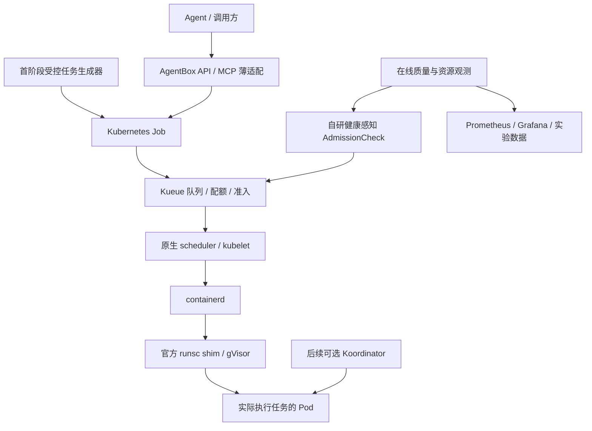

# AgentBox 系统设计

版本：V2.1｜更新：2026-10-25｜已决定退役 agentboxd；平台迁移及代码移除尚未实施。

AgentBox 面向 AI Agent 提供受控任务执行。目标采用 **Kubernetes Job＋Kueue＋containerd/gVisor 的单一执行链路**，健康感知 AdmissionCheck 是首个研发点，Koordinator 是后续节点控制基线。**agentboxd 及其直接调用 runsc 的本地执行后端退出目标架构，不再规划长期双后端。**

AgentBox 产品层仅负责鉴权、受控任务模板、提交/查询/取消和结果适配；容器管理、任务生命周期、排队与节点控制由成熟组件承接。不再把 agentboxd 改造成通用 containerd 客户端，也不自研 shim。退役是已确定的方向，现有代码仍可构建，新平台尚未交付；本次文档修改不等于已完成运行迁移。

本页只维护架构与关键取舍。阶段和验收条件见[路线图](docs/roadmap.md)，接口见[使用指南](docs/usage.md)，部署配置见[运维指南](docs/operations.md)，证据见[验证指南](docs/validation.md)。

## 1. 目标与范围

同时衡量受保护在线业务的正确及时成功率，以及平台任务的准入等待、按期完成、有效产出和积压。目标首版聚焦可排队、可重试且输出可校验的受控计算任务，不承诺旧同步 API、低延迟 Warm 命中或任意任务语义等价。CPU 利用率只是解释指标，不能靠长期阻止全部任务运行证明资源管理有效。

研究健康准入相对调优静态配额是否改善权衡，以及 Koordinator 对在途干扰是否有额外价值。功能正确和实验可信是必交付项；性能改善允许被实验否定。

现有本地 Python、Cold/Warm、FIFO、清理恢复、PSI/AIMD 及 Gateway/MCP 是已实现、待退役的旧链路。它们保留为迁移期复现和故障收尾依据，历史成绩不改写。Kubernetes 平台、AdmissionCheck、Koordinator 及新 API/MCP 适配均待实现和验证。

## 2. 组件职责与所有权

| 职责/对象 | 主体 | AgentBox 开发边界 |
| --- | --- | --- |
| Pod 运行与资源归属 | kubelet、containerd、gVisor RuntimeClass | 受控模板与隔离验证 |
| Pod 放置 | 原生 scheduler | 声明式资源与节点约束，不自行绑定 |
| Job、输入和结果引用 | 任务生成器，后续薄产品适配 | 创建模板化任务、查询和显式取消 |
| Pod 创建、重试与终态 | Job controller | 观察 attempt，不另建补偿任务系统 |
| Workload、队列、配额与基础准入 | Kueue | LocalQueue/ClusterQueue/ResourceFlavor 配置 |
| 在线健康检查项 | 自研 AdmissionCheck Controller | 仅维护自身检查、判定、恢复节奏和故障处理 |
| 可选节点动态压制 | Koordinator | 先用原生机制，后按证据选择一个扩展 |
| 监控与告警 | Prometheus、Grafana、现有 exporter | 少量业务/策略指标及 Dashboard |
| 在线压测、离线工作 | k6、现成图片库/后续 ffmpeg 或 PyTorch | 固定轨迹、数据、参数和输出校验 |
| 实验分析 | Python 工具 | baseline、消融、原始证据和质量判断 |

不新写通用批任务队列、配额账本、完整 Node Agent、调度器或监控数据库。API/MCP 适配不访问 containerd/CRI socket、不管理宿主 cgroup，不以新名字继续承担 agentboxd 职责。GPU、eBPF、会话快照和复杂多节点放置不进入首轮。

## 3. 唯一目标执行链路

整条链路为目标设计，尚未交付。首阶段由受控任务生成器提交真实 Job，之后接入新的 API/MCP 适配。图中箭头表示管理/执行关系，不表示所有组件之间都有同步 RPC；Kueue 控制准入，Job controller 管 Pod 生命周期，scheduler 负责放置。

| 旧能力 | 目标承接方式 | 迁移决定 |
| --- | --- | --- |
| runsc CLI 创建/exec/等待/删除 | containerd＋官方 runsc shim | 删除本地运行时适配，不自研替代 shim |
| 本地 FIFO、容量账本 | Kueue＋资源声明 | 不移植为第二套平台队列 |
| 一次性 Warm、动态 READY 库存 | 首版普通 Job 启动 | 退出交付目标，不要求功能等价 |
| 本地 cgroup AIMD/压力门控 | 静态资源边界、健康 AdmissionCheck、后续 Koordinator | 不把旧控制器带进新运行链路 |
| root Daemon＋Unix 转发 Gateway | 受限 Kubernetes API 客户端服务 | 旧配对服务随 Daemon 退役，可复用通用校验代码 |
| 同步 execute_python/get_status | 显式任务提交、状态查询和取消工具 | 版本化切换，不静默更改旧工具含义 |
| bundle/cgroup 清理确认 | Job/Pod 生命周期＋产物和资源收敛检查 | 保留验证要求，重新定义结果字段 |

**计算必须实际运行在受 Kueue 管理的 Job Pod 中。**不能让 Job 仅调用另一个 Daemon 的 HTTP，而把客户端的请求资源当成任务容量；也不在特权 Job 内旁路创建逃离 Pod 资源域的宿主沙箱。

迁移期间旧服务只用于已存任务收尾、必要修复和历史复现，不作为新平台依赖或自动回退目的地。验收后从活动发布中移除 agentboxd、本地执行路径和专用部署配置；退役步骤见[路线图](docs/roadmap.md#retirement)，原理保留在[旧运行时参考](docs/runtime.md)。

## 4. Kubernetes 平台与隔离契约

首轮一个专用实验 Worker，在线 Deployment 和离线 Job 固定在明确资源域；控制面、监控、压测器尽量在域外。单机环境记录共享 LLC、内存和内核干扰。kind 只用于 API、控制器和生命周期功能验证，不构成物理多机性能证据。

首批平台包括独立 namespace/节点标签、在线服务、受控 Job、Kueue 三类队列/资源对象、监控与 k6、runsc handler/RuntimeClass。先固定配额、资源规格，不借用、不抢占；Kueue 配额预留不是节点绑定或物理独占。ResourceFlavor 与允许节点集合对应，首版只映射一个 Worker。

锁定 Kubernetes、containerd、cgroup 驱动、内核、CNI、Kueue、监控 chart、runsc/shim、k6、任务镜像与库版本；不使用 latest，不复制与已安装 CRD 不匹配的示例。Koordinator 在后续阶段加入兼容矩阵。部署交付需包含只读 preflight、readiness、升级回退和仅清理本部署/run 对象的流程；不修改已有集群或宿主服务。

gVisor 通过 containerd 的正式 runtime handler 接入。RuntimeClass 不自动复制现有隔离策略，必须逐项验证：

- 服务端模板控制镜像 digest、entrypoint、线程数、资源、挂载、期限和重试预算；用户不能提交任意 PodSpec。
- 非 root、禁止提权、最小能力集、只读根、有界临时目录/输出/日志。
- 无 hostPath、hostNetwork、宿主设备/runtime socket、自动挂载的 Kubernetes API 凭据。
- 默认拒绝不需要的网络，验证 CNI/运行时效果；产物上传若需网络，限定目的地和凭据权限/有效期。
- 按 Job/Pod UID 核对业务线程、Sentry/Gofer 及祖先预算；运行时成本纳入记账或单独披露。

可信 runc smoke 可用于排障，但对外声明沙箱能力前必须通过 gVisor 同路径验收；正式策略比较固定 runtime。

## 5. 局部研发与节点控制

首个研发点使用官方外部 AdmissionCheck 协议和 controller-runtime：根据有效在线质量窗口对未准入 Workload 发出许可，不自行排队、预留配额或解除 Job suspend。样本失效、滞回、Pending 占配额、恢复风暴、Ready 到启动窗口和状态更新竞态，统一在[扩展设计](docs/admission-check.md)定义。

健康准入不能立即消除在途任务竞争。后续先运行原生 Koordinator CPU Suppress，记录实际 quota/cpuset 策略与作用域，不默认一并开启 CPU QoS、Burst、驱逐或额外调度优化。

Koordinator BE/LS 与 Kubernetes QoS 分开理解；引入 batch 扩展资源时，Kueue 配额、Pod 声明和节点 allocatable 的单位及预算必须一致。先保留原生 scheduler，额外调度/运行时依赖须单独验证和披露。目标运行链路不包含本地 AIMD，静态上限及祖先限制单独记录。

cpu.max 是上限，不保证最低 CPU 服务量。集成不稳定时保留已完成阶段，不用私有脚本抢写 cgroup 绕过所有权。原生机制足够时保留原生机制。

## 6. 批任务接口与结果契约

首版一个固定图片数据集和处理库：输入 manifest 含哈希、数量、尺寸，冻结解码/缩放/编码、线程和产物校验。输入分发与存储在 P0 选一种受控机制，明确容量、权限、持久性和清理；不开放任意宿主路径或把数据集塞入无界请求/ConfigMap。

产品仅做受控模板、提交关联、查询、取消和产物引用；生命周期复用 Job/Workload，不新增通用 BatchRun CRD 或调度数据库。稳定提交标识关联输入摘要，拒绝同标识不同输入；网络结果不确定时先查询同对象，不创建第二份 Job。

Job UID、Pod UID、attempt 隔离输出，结果发布要处理重复尝试。首版只接受可重试模板；准入幂等、提交去重与执行 exactly-once 是不同保证。Job 可能重复启动程序，失败和重试成本必须披露。

至少区分执行失败、校验失败、结果未知、验证成功、取消中和已取消。Job Complete 不自动表示产物正确，Pod 退出也不代表清理完成；不直接复用本地 cleanup_complete。保留结果摘要/引用后才 TTL 删除 Job，产物有独立保留期。

任务提交成功后断线不取消，显式取消按已确认身份执行并等待 Pod 收敛。接口和 MCP schema 必须版本化；旧请求不能在客户端不知情时变成可后台重试的 Job，新平台故障也不能回落到 agentboxd。实现前明确鉴权、租户与结果访问，再更新[使用指南](docs/usage.md)；目前没有新的任务端点。

## 7. 验证与生产边界

监控复用成熟组件，只补健康、准入、产出和控制成本指标；对象/run/request ID 放事件日志，避免无界标签。用[验证指南](docs/validation.md#platform)规定的静态基线和 B/A/K/AK 消融评价收益及等待代价，调参集与正式集分离，独立重复保留负向结果。

生产导向要求版本锁、最小权限、模板、预算、故障处置、结果/重试语义、升级回退、清理范围和容量告警。安装组件或 CRD 不等于生产就绪。普通磁盘超时及现有本地收益只按原版本证据表述，不被新后端或 tmpfs 通过替代。

## 8. 关键决策

| 决策 | 理由 | 重议条件 |
| --- | --- | --- |
| 退役 agentboxd，只交付成熟平台执行链路 | 收敛运行管理与资源所有权，不长期维护双后端 | 未来有独立低延迟需求时重新立项，不默认恢复旧后端 |
| Kueue 管队列和配额 | 收缩自研一致性范围 | 上游不满足已验证需求 |
| AdmissionCheck 是首个研发点 | 正式接口、职责明确、可做消融 | 证据不足时缩减扩展 |
| Koordinator 先用再改 | 评价成熟节点机制 | 有可复现策略缺口 |
| 不迁移本地 FIFO/Warm/AIMD 到目标平台 | 通用管理交给成熟组件，保留测试经验 | 独立需求与瓶颈证据 |
| 只选一个后续深挖方向 | 控制范围与实验变量 | 按阶段结果决定 |

## 9. 官方依据

来源用于定义接口语义，实际部署须锁定版本；不代表已完成组合验证。

- [R1 · Kueue AdmissionCheck](https://kueue.sigs.k8s.io/docs/concepts/admission_check/)
- [R2 · 开发 AdmissionCheck Controller](https://kueue.sigs.k8s.io/docs/tasks/dev/develop-acc/)
- [R3 · Koordinator CPU Suppress](https://koordinator.sh/docs/user-manuals/cpu-suppress)
- [R4 · Koordinator 资源模型](https://koordinator.sh/docs/architecture/resource-model)
- [R5 · Koordinator SLO 配置](https://koordinator.sh/docs/user-manuals/slo-config)
- [R6 · Kubernetes Job](https://kubernetes.io/docs/concepts/workloads/controllers/job/)
- [R7 · Kubernetes 资源管理](https://kubernetes.io/docs/concepts/configuration/manage-resources-containers/)
- [R8 · Linux cgroup v2](https://docs.kernel.org/admin-guide/cgroup-v2.html)
- [R9 · kube-prometheus-stack](https://github.com/prometheus-community/helm-charts/tree/main/charts/kube-prometheus-stack)
- [R10 · gVisor/containerd](https://gvisor.dev/docs/user_guide/containerd/quick_start/)
- [R11 · Kueue 原生 Job](https://kueue.sigs.k8s.io/docs/tasks/run/jobs/)
- [R12 · k6 到达模型](https://grafana.com/docs/k6/latest/using-k6/scenarios/concepts/open-vs-closed/)
