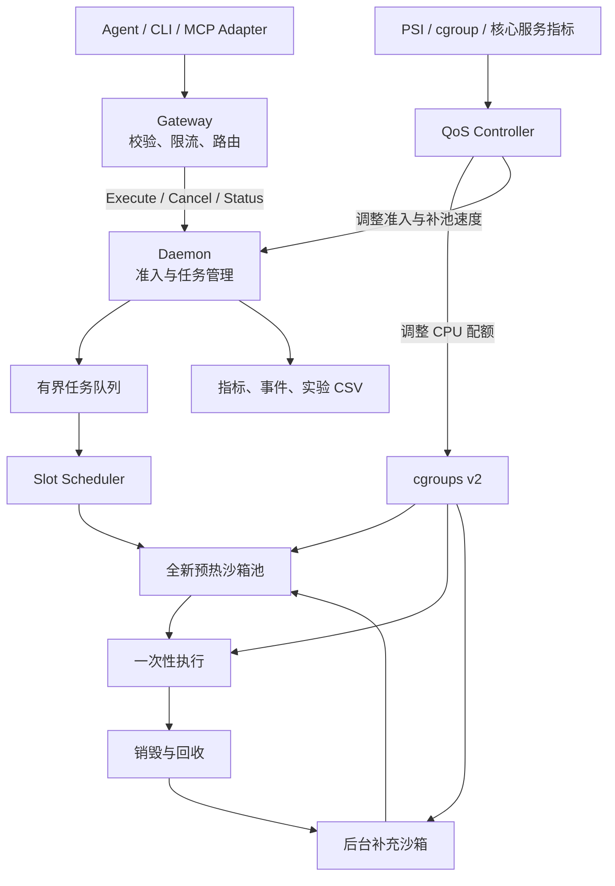
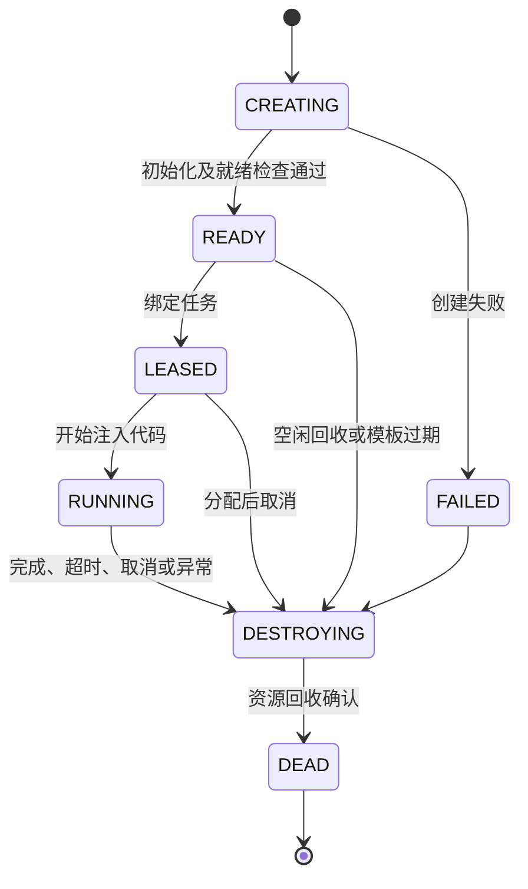

# AgentBox 系统设计

> 面向 AI Agent 的轻量代码执行沙箱
>
> **AgentBox: A Prewarmed Sandbox Runtime with PSI-Guided Resource Control**

- 文档版本：V1.0 设计草案
- 日期：2026-10-12
- 项目状态：设计阶段，尚未实现或进行性能验收
- 范围：本机 Linux 上的单机执行引擎；多节点、eBPF 和模型接入作为后续扩展

## 1. 项目定位与本机条件

AgentBox 面向不可信 Agent 代码执行，通过预热供给降低请求等待时间，通过 cgroups v2 与 PSI 反馈控制减少对同机服务的干扰。

本项目需要同时解决三个问题：

1. 不可信代码需要独立的执行与资源隔离边界。
2. 每次请求都从零创建运行环境，会增加交互延迟。
3. CPU、内存等资源失控时，执行任务不能无约束地影响同机核心服务。

### 1.1 本机只读检查结果

以下为设计讨论期间、2026-10-12 在当前工具执行环境中观察到的结果，不代表已经完成运行时能力验证。

| 项目 | 检查结果 | 对项目的意义 |
|---|---|---|
| 系统 | Ubuntu 22.04.5，Linux 6.8 | 具备实现基础 |
| CPU | i7-9750H，6 核、12 线程，支持 VT-x | 适合单机实验；12 线程不能当成 12 个完整物理核 |
| 内存 | 总计约 31 GiB，available 约 19 GiB | 可以从小规模沙箱池开始 |
| Swap | 已使用约 4.4 GiB | 测试时需要记录交换活动，避免干扰延迟结果 |
| cgroup | v2，包含 cpu、memory、pids、cpuset 控制器 | 资源控制底座具备 |
| PSI | CPU、memory 压力文件可读取 | 可以实现反馈采集 |
| KVM | 内核模块已加载，但当前工具环境看不到 `/dev/kvm` | 还不能认定项目能够使用 KVM |
| runsc | 当前 PATH 中未发现 | 后续需要安装并验证 |
| GPU | 当前环境中 `nvidia-smi` 无法连接驱动 | 本次检查无法确认 GPU 可用性 |

`/dev/kvm` 和 GPU 的结果受当前执行环境的设备可见性影响，不能据此断定宿主机缺少设备或驱动损坏。正式实施前，需要在实际运行 daemon 的环境中完成 KVM 功能验证。

### 1.2 对初始设想的修正

| 原假设 | 设计修正 |
|---|---|
| 没有嵌套虚拟化就只能用 ptrace | gVisor 从 2023 年起默认平台已经是 systrap |
| KVM 固定提升 5～10 倍 | 性能取决于负载，应对 KVM、systrap 做实测 |
| 单个沙箱约 15 MB | 必须测量 Sentry、Gofer、Python 和工作目录的整体开销 |
| 清空文件层就能安全复用 | 进程、内存、打开的文件、后台任务等状态仍可能残留 |
| 50 ms 读取 avg10 就能快速响应 | avg10 是较长时间尺度的趋势，不能作为唯一快速反馈信号 |
| 宿主 `pids.max=64` 精确限制沙箱内 64 个进程 | gVisor 内外的进程模型不一一对应 |
| cgroup socket eBPF 可以直接拦截所有沙箱连接 | 默认 netstack 路径需要换到实际经过的网络包拦截点 |
| 调整 `cpu.max` 就是内核内调度算法 | 决策在用户态，资源约束由内核执行 |

gVisor 官方建议裸机优先评估 KVM，无虚拟化支持或虚拟机环境优先评估 systrap，但没有保证固定性能倍数。参见 [gVisor 平台说明](https://gvisor.dev/docs/architecture_guide/platforms/)。

在实际测量之前，项目标题不包含 `Sub-50ms` 等性能承诺。所有性能数字必须注明工作负载、平台、资源配置及测量口径。

## 2. 第一版范围

第一版集中实现一个完整的单机执行闭环。

| 能力 | 第一版 | 后续扩展 |
|---|---|---|
| 代码执行 | Python、标准库、固定镜像 | Bash、额外依赖模板 |
| 隔离引擎 | runsc，显式选择 KVM 或 systrap | 平台性能优化 |
| 预热方式 | 一次性预热沙箱 | 干净快照恢复、会话沙箱 |
| 调度 | 有界队列、并发上限、后台补池 | 多租户公平调度 |
| 资源控制 | 静态上限＋PSI 动态 CPU 控制 | 更复杂的资源预测 |
| 网络 | 默认无外网 | 受控代理、TC eBPF |
| 接入 | HTTP Gateway＋内部 RPC | MCP 适配层 |
| 部署 | 本机 systemd | 多 Worker、Kubernetes |
| 演示 | Mock Agent、Mock 核心服务 | 本地模型工具调用 |

第一版的核心交付物是：能安全执行、能可靠结束、能恢复容量、能解释性能。

GPU、本地模型、Kubernetes 可以增加展示效果，但不作为核心执行链路的依赖。

## 3. 系统架构与组件边界

系统保留 Gateway 与 Daemon 两个边界。



| 组件 | 核心职责 |
|---|---|
| Gateway | 请求校验、鉴权、限流、选择 Worker、传播取消与期限 |
| Admission | 判断队列、执行槽位、内存预算是否允许接单 |
| Scheduler | 将任务绑定到唯一沙箱，处理排队和超时 |
| Pool Manager | 维护预热库存，限制创建并发和沙箱总数 |
| Runtime Adapter | 包装 runsc 生命周期，隐藏 CLI 和版本差异 |
| QoS Controller | 读取信号、计算动作、更新配额与准入状态 |
| Reconciler | 清理孤儿沙箱、失败资源和重启前残留 |
| Observer | 输出指标、结构化事件和基准测试数据 |

网络入口和特权操作分开。Gateway 使用普通用户运行；需要操作 cgroup、挂载和 runsc 的执行管理组件只暴露本机受保护接口。

第一版不引入 etcd、Redis 或数据库来完成单机闭环。

## 4. 预热池生命周期与隔离语义

### 4.1 一次性沙箱

执行任意 Python 代码后，即使删除工作目录，也不能证明以下状态已经消失：

- Python 全局变量、模块缓存、修改过的运行环境；
- 子进程、后台线程、打开的文件描述符；
- 信号处理器、共享内存、其他内核对象；
- 运行时被攻击后产生的异常状态。

因此，第一版采用明确的隔离语义：

> 一个沙箱只执行一个任务；任务结束后销毁整个沙箱，由后台创建新实例补充库存。



不存在 `RUNNING → READY` 的转换。

### 4.2 后续模式

| 模式 | 状态语义 |
|---|---|
| 一次性任务 | 每次领取全新环境 |
| 会话任务 | 只在同一个会话中保留状态，结束后销毁 |
| 快照恢复 | 从已验证的干净模板恢复为新实例 |

gVisor 提供 checkpoint/restore，但恢复兼容性、文件系统一致性、连接和随机状态都需要单独验证，作为后续性能优化。参见 [gVisor Checkpoint/Restore](https://gvisor.dev/docs/user_guide/checkpoint_restore/)。

## 5. 预热与任务注入流程

“预热完成”包含解释器初始化，而不只是创建容器。

1. 提前创建 OCI bundle 和独立资源限制。
2. 启动 runsc 沙箱。
3. 沙箱中的 Python 启动程序完成固定初始化。
4. 启动程序报告 READY，阻塞等待一次任务输入。
5. Daemon 分配任务，通过已建立的管道写入代码和参数。
6. Python 执行该任务，宿主侧持续读取输出。
7. 宿主侧确认退出或触发终止。
8. 销毁沙箱并补充一个新实例。

请求到来时不需要重新创建容器和初始化 Python。

协议设计必须满足：

- **READY 与用户输出有明确分界。** 用户打印的文本不能被解释为宿主控制命令。
- **运行结果以宿主观测为准。** 超时、OOM、退出状态不能只相信沙箱自己报告的数据。
- **输入使用结构化协议。** 代码、环境变量都不能拼接进宿主 shell 命令。

预热沙箱阻塞等待输入；第一版不使用 cgroup freezer，避免增加解冻和健康检查的复杂度。

## 6. 本地调度、准入与补池

### 6.1 初始参数

以下是保守的实验起点，不是已经验证的最优配置。

| 参数 | 初始建议 |
|---|---:|
| READY 目标数量 | 4 |
| 同时执行任务数 | 4 |
| 同时创建沙箱数 | 2 |
| 沙箱总数上限 | 8 |
| 排队任务上限 | 16 |
| 最大排队时间 | 100 ms |
| 默认执行时限 | 5 s |
| 执行时限硬上限 | 30 s |
| 单请求代码大小上限 | 256 KiB |
| stdout＋stderr 总上限 | 1 MiB |

总数上限覆盖 `CREATING、READY、LEASED、RUNNING、DESTROYING`，不能只数正在运行的实例。否则清理缓慢时，补池会不断创建新实例。

### 6.2 调度策略

- 第一版使用 FIFO。
- 同时限制任务数量与排队输入总字节数。
- 队列已满或等待到期时明确拒绝。
- READY 用尽时等待后台补池，不偷偷切换到另一套冷启动路径。
- 创建失败采用有上限的退避。
- 节点进入高压状态后减少接单和补池并发。
- 沙箱创建、销毁也计入资源和吞吐成本。

### 6.3 持续吞吐约束

预热可以吸收突发，但持续吞吐受补池能力约束：

$$
\lambda_{\text{steady}}
\leq
\min\left(
\frac{C_{\text{run}}}{T_{\text{exec}}},
\frac{C_{\text{create}}}{T_{\text{create}}},
\text{CPU 与内存允许的吞吐}
\right)
$$

其中，`C_run` 是执行并发，`T_exec` 是执行耗时，`C_create` 是创建并发，`T_create` 是创建耗时。

例如，如果实测创建耗时为 200 ms、创建并发为 2，那么仅补池这一项的理想上限就是约 10 个新沙箱/秒。即使前几个任务在 10 ms 内完成，也不能据此宣称持续达到 100 QPS。

## 7. API 与执行语义

### 7.1 外部 HTTP 接口

对外保留 `POST /v1/execute`，第一版采用同步返回。

请求字段：

| 字段 | 用途 |
|---|---|
| `request_id` | 请求追踪和有范围的去重 |
| `runtime` | 第一版固定为 Python |
| `code` | 待执行代码 |
| `stdin` | 程序输入 |
| `timeout_ms` | 请求时限，服务端执行上限约束 |
| `env` | 允许列表内的任务环境变量 |

资源档位由服务端决定，不开放任意镜像、宿主路径、挂载和 runsc 参数。实现时需要明确端到端期限、排队期限与执行期限的关系，并在 Gateway 和 Worker 之间传播剩余预算。

响应字段：

| 字段 | 用途 |
|---|---|
| `execution_id` | 本次执行标识 |
| `status` | `succeeded / failed / timeout / oom / cancelled / output_limit / infrastructure_error` |
| `exit_code` | 有明确退出状态时返回 |
| `stdout / stderr` | 有界输出 |
| `timings` | 排队、分配、执行、总耗时 |
| `usage` | CPU、内存等观测数据，并说明统计口径 |
| `worker_id` | Worker 标识 |

HTTP 语义：

- 参数错误：400。
- 调用方限流：429。
- Worker 无可用容量：503。
- 已完成的代码执行：200，具体执行结果放在 `status` 中。

### 7.2 内部 RPC

内部 RPC 至少包含：

- `Execute`
- `Cancel`
- `GetExecution`
- `GetNodeStatus`

单机先通过 Unix socket 通信，多机再增加网络身份认证。

### 7.3 去重与不确定结果

发生超时或断线后，不自动跨节点重执行。只有确认任务尚未被接收时才可以安全改投。

第一版可以保证同一 daemon 实例内的请求去重，但不能宣称跨重启的 exactly-once。去重记录需要有明确的容量和保留时间限制。

## 8. cgroups v2 资源隔离

资源隔离必须先于动态控制存在。

### 8.1 逻辑层级

使用 systemd 明确委派的子树：

```text
受保护服务所在 cgroup
├── Gateway
└── Mock Core Service

AgentBox 获得委派的子树
├── manager
│   └── daemon / controller
└── sandboxes
    ├── sandbox-a
    ├── sandbox-b
    └── sandbox-c
```

Daemon 和被保护服务都不放在动态压制的 `sandboxes` 下，否则过载时会连控制器一起限速。

在 systemd 管理的机器上，通过 delegation 明确 cgroup 所有权，避免多个管理者同时修改同一层级。参见 [systemd cgroup 委派说明](https://systemd.io/CGROUP_DELEGATION/)。

### 8.2 初始预算

| 层级 | 资源预算建议 |
|---|---|
| 沙箱整体 CPU | 初始 4 个逻辑 CPU 等效带宽，动态范围 1～6 |
| 沙箱整体内存 | `memory.high` 3 GiB，`memory.max` 4 GiB |
| 单沙箱 CPU | 最多 1 个逻辑 CPU 等效带宽 |
| 单沙箱内存 | `memory.high` 384 MiB，`memory.max` 512 MiB |
| 沙箱 Swap | 初始设为 0，保证实验口径稳定 |
| 工作目录 | `/workspace` 与 `/tmp` 合计建议上限 128 MiB |
| 单沙箱 OOM 策略 | 作为整体失败并销毁 |

512 MiB 包括执行环境和运行时开销，不能全部宣称为用户代码可用内存。

`memory.high` 触发限速与回收压力；`memory.max` 是硬限制，无法回收时可触发该 cgroup 内的 OOM。它们不等于“主动换页通知”，也不能保证其他宿主负载永远不会引发全局 OOM。参见 [Linux 6.8 cgroup v2 文档](https://docs.kernel.org/6.8/admin-guide/cgroup-v2.html)。

需要验证 Sentry、Gofer 及相关辅助进程的实际归属，不能只给 runsc 的启动命令设限制。

## 9. 进程与内存限制的验证

gVisor 内部进程不直接对应宿主进程，因此不能用宿主 `pids.current` 推断沙箱内已经 fork 了多少次。参见 [gVisor 资源模型](https://gvisor.dev/docs/architecture_guide/resources/)。

分别设计三个层面：

- **宿主层：** `pids.max` 限制运行时产生的宿主任务，数值按所选平台实际开销确定。
- **沙箱层：** 非 root 用户运行，配置进程数等 rlimit，并验证固定 runsc 版本下的执行效果。
- **兜底层：** CPU、内存、墙钟时限，以及完整沙箱终止。

“最多 64 个应用进程”可以成为验收目标，但必须通过沙箱内观测和受控测试证明。

内存优先观察完整 cgroup 的用量；gVisor 应用内存可能计入 shmem/file，不能只看 `anon`。参见 [gVisor 内存记账说明](https://gvisor.dev/docs/architecture_guide/resources/#limits)。

## 10. PSI 反馈 QoS 控制

### 10.1 控制目标与信号

控制以被保护服务为目标，PSI 作为反馈信号。

只控制宿主 `CPU PSI some avg10 ≤ 15%` 存在两个问题：

1. avg10 对短时突发不够敏感。
2. 沙箱自身被限流后，也可能持续表现出等待压力，诱发重复降配额。

同时观察以下信号：

| 信号 | 作用 |
|---|---|
| 宿主 CPU PSI | 判断整体争用背景 |
| 被保护服务 cgroup CPU PSI | 判断核心业务是否受到影响 |
| 核心服务请求延迟、错误率 | 验证用户可见效果 |
| 沙箱 CPU PSI 与 `cpu.stat` | 解释限流成本，辅助归因 |
| 内存 PSI、内存用量和 OOM 事件 | 内存准入与熔断 |
| READY 数量、队列深度 | 判断供给是否不足 |

### 10.2 快速压力估计

使用累计 stall 时间差：

$$
P_t =
100\times
\frac{\Delta \text{stall\_total\_us}}
{\Delta \text{monotonic\_time\_us}}
$$

每 50 ms 采样，结合短窗口平滑值决策，avg10 留作趋势展示。内核文档说明 `total` 可用于捕获平均值中不明显的短时压力。参见 [Linux PSI 文档](https://docs.kernel.org/6.8/accounting/psi.html)。

### 10.3 初始控制参数

| 项目 | 初始设计 |
|---|---|
| 采样周期 | 50 ms |
| 决策周期 | 100 ms |
| CPU bandwidth 周期 | 20 ms，后续与 100 ms 对照 |
| 下降动作 | 当前 CPU 预算乘以 0.5 |
| 两次下降最小间隔 | 500 ms |
| 恢复条件 | 核心服务压力低、延迟正常，持续至少 1 s |
| 恢复步长 | 每秒增加 0.25 个 CPU 等效带宽 |
| 压力阈值 | 10%／20% 仅作为待校准起点 |

所有配额动作均受最小、最大预算约束。

### 10.4 控制状态

| 状态 | 触发与动作 |
|---|---|
| NORMAL | 正常接单与补池 |
| PRESSURED | 受保护服务持续受影响，降低 CPU 预算与接单速度 |
| RECOVERING | 压力解除后缓慢增加预算 |
| EMERGENCY | 内存危险或保护指标严重恶化，停止接单并按策略回收 |
| DEGRADED | 采集或控制失败，保留静态上限并停止扩容 |

约束：

- 不因为沙箱自己的 PSI 高就持续减半。
- 写入失败不能被记录成“控制成功”，必须保留实际配额和错误状态。
- `cpu.max` 限制一定周期内的 CPU 时间，不代表独占 CPU 核心。
- 后续可以用 cpuset 做隔离对照实验，但不要混在同一组实验里，否则无法识别 AIMD 的贡献。

## 11. 文件系统与网络安全

### 11.1 文件系统

- 固定并记录镜像 digest。
- 根文件系统只读。
- `/workspace`、`/tmp` 独立且限额。
- 沙箱内使用非 root 用户，清空 capabilities，设置 `no_new_privs`。
- 不挂载宿主工作目录、Docker socket、Kubernetes 凭据。
- 不继承 daemon 的全部环境变量。
- 不向沙箱提供宿主 `/dev/kvm` 或 GPU 设备。

第一版不需要让整个根文件系统可写，因此不必一开始引入宿主 OverlayFS 的完整生命周期管理。

### 11.2 网络策略

| 版本 | 策略 |
|---|---|
| V1 | 无外网，只保留沙箱内部所需通信 |
| V2 | 指定代理出口＋实际数据路径上的网络过滤 |

gVisor 默认 netstack 使用自己的网络栈，通过底层包接口收发流量。据此可推断，不能把宿主 `cgroup/connect4/connect6` 当成应用连接的通用拦截点。参见 [gVisor 网络架构](https://gvisor.dev/docs/architecture_guide/networking/)。

后续如需实现 eBPF，采用沙箱独立网络命名空间和 veth，在宿主侧对应 veth 的 TC hook 上验证并过滤沙箱流量。

策略需要覆盖 IPv4、IPv6、链路本地地址、宿主及实验网络段。若采用域名允许列表，还要处理解析结果、重定向与 DNS rebinding。

不为了适配 socket hook，直接把默认网络换成 host networking。

## 12. 退出、取消与崩溃恢复

| 情况 | 系统行为 |
|---|---|
| 排队超时 | 从队列移除，保证后续不会执行 |
| 执行超时 | 终止整个沙箱，等待资源回收 |
| 客户端断开 | 默认取消任务，传播到 Worker |
| 输出超限 | 标记 `output_limit` 并终止，宿主持续有界处理管道 |
| 沙箱 OOM | 结合 cgroup 事件识别，销毁实例 |
| runsc 异常退出 | 返回基础设施错误，不把实例重新投入池 |
| 创建连续失败 | 退避并将节点标记为不可接单 |
| 清理失败 | 实例继续占用总量预算，交给回收器处理 |
| daemon 重启 | 枚举本项目资源并清理，不恢复使用旧 READY 实例 |

“杀掉 runsc CLI”不能直接等同于“沙箱已终止”。验收必须检查执行进程和资源是否确实消失。

Daemon 持有实例锁，资源带有本项目与 daemon 实例标识。清理器只处理能够确认归属的对象，避免通过模糊 PID 或目录匹配误清理其他项目。

## 13. 可观测性

观测数据同时服务于调试和实验。

| 类别 | 关键指标 |
|---|---|
| 请求 | 接收、拒绝、排队、成功、超时、OOM、执行耗时 |
| 预热池 | READY、RUNNING、CREATING、销毁中数量，创建耗时、补池失败 |
| 资源 | CPU 用量和节流、内存用量、PSI、OOM 事件 |
| 控制器 | 当前 CPU 预算、状态、增减动作、动作原因、写入失败 |

每个请求至少记录以下时间点：

- Gateway 接收；
- Worker 接收；
- 入队与出队；
- 沙箱分配；
- 输入发送；
- 首字节输出；
- 执行结束；
- 清理完成。

请求 ID 放在日志和 trace 中，不作为 Prometheus label，避免高基数。

Prometheus 用于长期观察。50 ms 级控制实验额外输出本地 CSV 或事件文件，并使用单调时钟计算时间差；普通秒级抓取不足以证明 100 ms 的响应过程。

## 14. 基准实验与验收

### 14.1 实验 A：延迟分解

使用相同 Python 环境、资源限制和输入，比较：

| 方案 | 测量重点 |
|---|---|
| runc 冷启动 | 普通容器基线 |
| runsc 冷启动 | 隔离运行时初始化成本 |
| AgentBox 预热命中 | 已准备实例的请求路径 |
| AgentBox 池耗尽 | 排队、拒绝和补池行为 |
| Kubernetes Job/Pod | 完整编排路径成本，单独解释 |

镜像预拉取，明确是否包含镜像下载。记录平台、runsc 版本、镜像 digest、CPU 温度和后台负载。

指标包括 P50/P95/P99、成功率、排队时间、READY 命中率、创建耗时和清理耗时。

`P99 < 50 ms` 可以先设为轻量 Python 任务、预热命中条件下的研究目标；不能作为所有任务的保证。

### 14.2 实验 B：持续吞吐

连续运行数分钟，使用不同到达率和任务类型：

- 极短打印任务；
- 固定 CPU 工作量；
- 受控内存分配；
- 工作目录 I/O；
- 混合任务。

同时报告 offered QPS、accepted QPS、completed QPS 和拒绝率。使用开放式发压，防止服务变慢时发压器也自动减速，掩盖排队问题。

重点观察预热库存是否持续耗尽，以及销毁和补充能否稳定跟上。

### 14.3 实验 C：QoS 收益

至少比较三组：

| 对照组 | 目的 |
|---|---|
| 仅静态资源上限 | 实际可用的简单基线 |
| 较保守的固定 CPU 配额 | 判断静态配置是否已经足够 |
| 静态上限＋动态控制 | 衡量自适应收益 |

Mock Core Service 有固定 CPU 工作量，先测无沙箱干扰的基线。再注入可控的 CPU 负载，记录业务延迟、错误率、吞吐，以及沙箱吞吐损失。

图中同时画出核心服务延迟、PSI、CPU 配额和任务吞吐。控制动作延迟与业务恢复时间分开计算；短窗口样本不足时，不应声称得到可靠的 P99。

### 14.4 实验 D：隔离与恢复

| 测试 | 验收内容 |
|---|---|
| 死循环 | 超时后整个沙箱终止 |
| 内存持续分配 | 限制生效，核心服务可用 |
| 受控 fork 测试 | 验证沙箱内限制与宿主限制的实际关系 |
| 输出洪水 | 宿主内存有界、接口可终止 |
| 文件污染 | 下一任务得到全新工作目录 |
| 环境变量探测 | 无宿主秘密泄露 |
| 后台子进程 | 主任务结束后无残留实例 |
| 网络请求 | 与当前网络策略一致 |
| daemon 重启 | 孤儿资源可识别并回收 |

文件系统测试使用沙箱内专用测试目录和宿主哨兵文件校验。`rm -rf /` 不作为核心验收指标，因为命令保护和权限失败会使结果难以解释。

这些用例证明已测试策略的效果，不能包装成“证明不存在逃逸漏洞”。

## 15. 代码组织与测试边界

后续仓库按以下边界组织。本节是计划，不代表这些目录或代码已经创建。

```text
AgentBox/
├── cmd/
│   ├── gateway/
│   ├── daemon/
│   ├── mock-core/
│   └── bench/
├── api/
│   └── proto/
├── internal/
│   ├── gateway/
│   ├── admission/
│   ├── scheduler/
│   ├── pool/
│   ├── sandbox/
│   ├── cgroup/
│   ├── pressure/
│   ├── qos/
│   ├── reconcile/
│   ├── telemetry/
│   └── config/
├── guest/
│   └── python-bootstrap/
├── images/
├── deploy/
│   └── systemd/
├── scripts/
├── tests/
│   ├── integration/
│   └── isolation/
├── benchmarks/
│   ├── workloads/
│   └── analysis/
├── docs/
│   ├── threat-model.md
│   ├── benchmark-methodology.md
│   └── adr/
└── DESIGN.md
```

eBPF、Kubernetes 和 MCP 等组件在相应阶段再加入。

单元测试重点覆盖状态机竞争、队列取消、配额边界、滞回和故障恢复。真实 runsc 集成测试单独运行；没有运行时能力的测试环境明确跳过，不能用 mock 的通过结果代替隔离验证。

建议组件命名：

- 项目与仓库：AgentBox / `agentbox`
- Gateway 二进制：`agentbox-gateway`
- Daemon 二进制：`agentboxd`

## 16. 多节点与本地模型扩展

### 16.1 多 Worker 路由

先在本机启动几个 daemon 实例，每个拥有独立资源子树和运行目录，不必立即引入 kind。

Gateway 根据以下信息筛选节点：

- 状态是否新鲜、是否可接单；
- READY 数量和队列深度；
- 当前执行数和创建速度；
- 可用资源预算；
- QoS 状态。

节点上报只是路由提示，最终准入仍由 Worker 原子完成，避免多个 Gateway 同时抢占同一个空闲名额。

kind 可以验证注册、路由和故障处理，但多个容器节点仍共享宿主机的 CPU、内存和 PSI，不能替代独立物理节点的资源隔离实验。runsc 安装、KVM 设备暴露和 cgroup 委派也需要分别配置。

### 16.2 本地模型接入

本地模型作为外部客户端：

> 模型生成代码 → 调用执行接口 → 获取结果 → 继续推理。

模型服务不进入任务沙箱，GPU 不暴露给任务。先用 Mock Agent 验证协议，再加入实际模型，执行性能实验与模型演示分别记录。

## 17. 开发阶段、验收门槛与工期

| 阶段 | 交付物 | 进入下一阶段的条件 | 粗略工时 |
|---|---|---|---:|
| 环境验证 | runsc、平台、cgroup、无网执行验证 | 选定平台能实际运行且限制生效 | 3～6 h |
| 单次执行 | Python 执行、超时、输出限制、完整销毁 | 无残留任务，异常可解释 | 6～10 h |
| 预热池 | READY 库存、有界队列、后台补池 | 连续任务运行稳定 | 8～12 h |
| QoS | 采集、静态限制、动态控制和降级 | 配额动作正确，故障时保持约束 | 8～12 h |
| 实验与文档 | 原始数据、图表、对照实验 | 性能结论可复现 | 8～16 h |

工期仅为规划估计：20～25 小时可以争取做出最小演示；包含故障处理和可信实验的完整第一版，更适合预留约 35～55 小时。这不包括 eBPF、多节点和模型服务调优。

项目优先形成三项可验证成果：

1. 一次性预热沙箱的低延迟执行。
2. 包含补池成本的持续供给能力。
3. 可量化收益和代价的 PSI 反馈控制。

先完成这三项，再根据实验瓶颈扩展快照恢复、多节点路由、eBPF 和模型接入。
