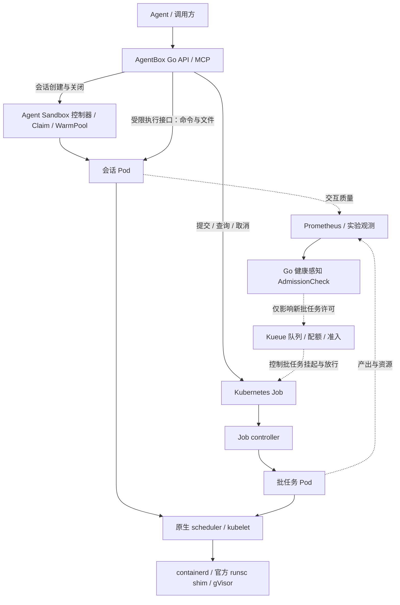

# AgentBox 系统设计

版本：V3.0｜更新：2026-10-29｜方向已确定；当前提供普通 Job、gVisor 运行时与 Calico 网络策略实验入口；已增加上游冷会话、固定预热池/Go SDK 验收入口；完整产品安全边界、新接口与 agentboxd 实际退役仍待实现。

AgentBox 面向 AI Agent 提供隔离会话与受控批任务。目标在同一 Kubernetes 平台上复用 **Agent Sandbox 管理会话和预热池，Job＋Kueue 管理批任务，containerd＋gVisor 承担实际运行与隔离**。Go 产品层提供 API/MCP 适配，首个局部研发点是保护交互体验的健康感知批任务 AdmissionCheck。

继续在现有项目内演进，不另建同类平台。**agentboxd 及其直接调用 runsc 的本地后端退出目标架构，不保留长期双后端或请求级自动回退。**会话与批任务是同一平台内的两类工作负载；不再强制每条 Agent 命令创建一次性 Job。

本页维护架构与取舍；阶段见[路线图](docs/roadmap.md)，契约见[使用指南](docs/usage.md)，部署边界见[运维指南](docs/operations.md)，测量与证据见[验证指南](docs/validation.md)。

## 1. 目标与范围

研究问题：在固定预热池与共享资源预算下，健康感知批任务准入，能否比调优后的静态配额更好地兼顾会话响应与批任务有效产出？同时衡量首次可执行等待、后续命令延迟/正确及时成功、批任务等待/按期完成、池耗尽和空闲资源成本。CPU 利用率仅作解释指标，长期阻止全部批任务不能证明策略有效。

首版限定一个 Worker 资源域、一种管理员维护的 CPU/Python 镜像模板、少量会话、一份固定图片处理数据集。镜像提前安装依赖。会话首版保存工作目录并顺序执行命令；不承诺跨命令 Python 内存变量、跨 Pod 重启内存恢复或 Notebook 协议。批任务使用固定、可重试、输出可校验的程序，不直接接收任意 PodSpec。

先完成真实平台、Go 接口与故障验收，再写一个资源策略。动态预热池、Koordinator、Firecracker 快照、GPU、多节点放置、多租户公平、Argo/Ray/KEDA 和额外消息队列均不同时进入首轮。性能改善允许被实验否定；不承诺旧 Warm 时延或任意运行环境兼容。

已实现的本地 Cold/Warm、FIFO、PSI/AIMD、Gateway/MCP 保留为迁移收尾和历史复现。普通 Job 基线和新 gVisor 运行时子步骤分别留证；运行时探针不证明完整网络隔离、上游会话生命周期、新 API/MCP 或策略收益。

## 2. 组件职责与所有权

| 职责/对象 | 主体 | AgentBox 开发边界 |
| --- | --- | --- |
| 会话环境与预热供给 | Kubernetes SIGs Agent Sandbox：Sandbox/Template/Claim/WarmPool | 选择受控模板、领取、查询、关闭；固定池规模，不重写池控制器 |
| 会话内命令与文件访问 | 上游 SDK/路由及沙箱内执行服务 | Go API/MCP 做鉴权、会话身份关联、预算和结果适配；不在宿主执行代码 |
| 批任务 Pod、重试与终态 | Kubernetes Job controller | 生成模板化 Job、观察 attempt、验证产物与显式取消 |
| 批任务队列、配额与准入 | Kueue | 配置 LocalQueue/ClusterQueue/ResourceFlavor，不自建队列账本 |
| 批任务健康检查项 | 自研 Go AdmissionCheck Controller | 只维护自身检查状态、滞回、恢复节奏和故障行为 |
| Pod 放置与运行 | 原生 scheduler、kubelet、containerd、官方 runsc shim/gVisor | 声明资源、节点约束、RuntimeClass，并验收实际效果 |
| 可选运行中资源压制 | 后续原生 Koordinator | 仅在在途竞争成为明确瓶颈时评价一个策略 |
| 观测与压测 | Prometheus/Grafana、现有 exporter、k6 等工具 | 补充会话/批任务/策略指标和确定性轨迹 |
| 环境与实验分析 | Python 工具 | 安装验收编排、原始证据、baseline 与绘图；不承担常驻任务服务 |

Go API/MCP 可使用必要 Kubernetes API 和受限的上游执行接口，不取得 containerd/CRI socket 或宿主 cgroup 写权限。上游沙箱内执行服务与节点 kubelet/containerd 仍是常驻进程；退役的是自研宿主运行管理 daemon，不是消除所有 daemon。

## 3. 平台执行与控制关系

图为目标设计，箭头表示声明、管理或观测关系，不是同步 RPC 调用栈。预热 Pod 在请求到来前已创建；命令在已领取的会话 Pod 内执行，不经过一次新的 Pod 调度。批计算必须在其受 Kueue 管理的 Job Pod 内执行，不能用 Job 调另一个执行集群却把客户端资源当成计算预算。

首版 Kueue 只管理批任务。会话和预热池使用固定规模、资源声明及独立 namespace/ResourceQuota；总预算包括空闲、已领取、创建中和终止中的沙箱。配额上限不等于物理预留，需要节点资源与在途预算验证。上游虽有 Kueue/Agent Sandbox 集成示例，但把预热 Pod 纳入配额不等于对每次 Claim 或命令准入；该组合不进入首轮。

## 4. 会话生命周期契约

受控模板 → 申请/领取 → 就绪 → 多次执行和文件访问 → 显式关闭或到期 → 资源回收。Sandbox/Claim/Pod 的状态以锁定版本的上游控制器为准；产品状态只是带身份和原因的映射，不新增第二套生命周期 CRD。

典型交互采用逐次工具调用：模型生成一次执行请求，Agent 程序在绑定的会话中执行并回传结果，模型再决定下一次调用；无需提前提供整套代码。模型对话历史由 Agent 程序维护，沙箱保存执行环境与工作文件，两种状态分别管理。

等待模型响应时，沙箱 CPU 用量通常较低，但内存、文件、Pod 资源请求与会话名额仍可能占用；已领取会话数、正在执行的命令数和未领取预热数量分别统计。会话粒度、空闲判定、回收/暂停及容量调整策略暂不确定，先测量执行与等待的比例、后续调用收益和保留成本，再作取舍。

- 冷创建、预热领取、第一条命令和后续命令分别测量。池耗尽的等待/失败行为须有界并在接口公开，不用无限补池掩盖容量不足。
- 同一会话可保留文件；每次启动新 Python 进程不保留前一进程变量。首版每会话最多一个执行中命令，冲突明确拒绝，不暗建命令队列。
- 会话、请求与命令标识关联上游 UID。创建响应丢失时按稳定标识查询；执行结果未知时不自动重放。无法恢复命令结果时返回 unknown 并关闭该会话收敛，不假造 exactly-once。
- 命令截止、会话期限和资源清理预算分开。断线不代表命令已停止；执行协议须明确取消/终止能力，不能确认任务结束时关闭整个会话并等待回收，不能直接继续执行。
- 关闭后拒绝新命令，确认对应 Pod 及临时资源收敛；使用过的会话不得归还为干净预热成员。首版工作目录随会话清理，需保留的产物先导出。
- 不将模型 API key、集群凭据或宿主路径传给任务。会话归属和文件访问范围由 Go 产品层检查，不能只凭用户提供的 sandbox ID 访问。

冷会话实现固定 Agent Sandbox v1.0.8，使用上游 sandboxd（同版本 Go 模块构建）与 Go SDK。可信客户端通过集群内 headless Service 访问 REST 8080/执行 gRPC 9090；gVisor 不依赖 Pod port-forward。Template 管理自定义 NetworkPolicy，仅放行独立客户端 namespace/Pod，任务出口只允许 DNS，控制凭据只在受限客户端。当前为单次运行的验收程序：默认 cold profile 的 replicas=0；warm profile 的固定库存目标为 2，另用总 Pod quota 3 验证容量边界。固定目标不等于总并发上限，池空时上游仍可尝试冷创建；没有预算时等待有界并核对失败回滚。这不表示产品鉴权已交付，见[操作边界](docs/operations.md#cold-sessions)。

故障验收增加控制器重启时的数据面连续性、执行 Pod 丢失后的 UID/工作目录变化，以及到期与关闭的终态收敛。Claim 或 Service 名称相同不等于原环境仍存在；验收器按实际 Pod UID 识别变化，不对旧句柄重放命令。产品层的逐请求身份防护在 P2 实现，当前不承诺 Pod 丢失后的透明恢复。

具体端点、字段和工具名在实现时版本化定义，当前没有新会话 API。新链路验收通过前保留旧调用方，切换与退役见[路线图](docs/roadmap.md#retirement)。

## 5. 平台与隔离契约

先完成 gVisor 真实执行，再接入 Agent Sandbox。独立 namespace/节点标签、受限 RBAC、可执行 NetworkPolicy 的 CNI、镜像 digest 和可观察的清理边界是交付内容。kind 只证明功能；同机节点共享内核、LLC、内存和磁盘，不能当物理多机性能证据。

锁定 Kubernetes、containerd、内核/cgroup 驱动、CNI、runsc/shim、Agent Sandbox 控制器/CRD/SDK/执行服务的兼容组合；批任务阶段再锁 Kueue，后续再评价 Koordinator。上游版本和 CRD API 稳定程度分别记录，不复制 main/latest 示例作为发布配置。安装必须可预检、诊断、回退和仅清理本部署对象。

RuntimeClass 不自动保证完整隔离，需逐项验证：

- 任务进程、Sentry/Gofer 与祖先预算归属正确；会话 Pod 和 Job Pod 都实际经过 gVisor，不自动回落普通 runtime。
- 管理员控制镜像、entrypoint、线程、资源、挂载、期限和重试；非 root、禁止提权、最小能力、只读根与有界工作目录/输出。
- 无 hostPath、hostNetwork、宿主设备/runtime socket 或自动挂载的 Kubernetes API token。控制器的权限不进入执行 Pod。
- 仅允许执行控制通道和必要输入/产物通道；默认拒绝其余流量，以真实网络测试验证。普通同 Pod sidecar 不是独立网络安全边界，不假设 NetworkPolicy 能按容器区分出口。
- 输入/输出按会话或 Job/attempt 身份隔离。文件访问防越界与符号链接逃逸，产物按容量、类型和校验规则接收。

首版选择一种受控输入/产物机制，明确权限、容量、保留期与清理；不引入通用存储平台。沙箱降低攻击面，资源竞争、网络和数据权限仍需单独治理；不承诺绝对防逃逸或消除共享硬件干扰。

## 6. 批任务与结果契约

首个负载是固定图片数据集与处理库；冻结 manifest 哈希、数量、尺寸、编码/线程参数和输出校验。一个 Job 处理一份有界输入或一个分片，任务粒度由启动成本与失败代价测量决定，不默认每张图片创建 Pod。

Go 产品层提供提交、查询、取消和产物引用；Job/Workload 承担生命周期，资源规格固定，首版不借用、不抢占。稳定提交标识绑定模板与输入摘要，同标识不同内容拒绝；传输不确定时查询同一对象，不补建另一份 Job。

Job/Pod UID 和 attempt 隔离输出，发布结果处理重复尝试。Job Complete 不等于产物正确；区分执行失败、校验失败、结果未知、验证成功、取消中与已取消。提交后断线继续，显式取消等待资源收敛；结果摘要保存后再 TTL 清理，产物有独立保留期。

会话与批任务通过输入清单和产物引用衔接。Agent 可以在会话内试验，再由可信产品层提交已允许的批模板；首版不自动把任意生成脚本提升为可信批程序，不让沙箱自行创建 Kubernetes 工作负载。

## 7. 局部研发与验证边界

健康 AdmissionCheck 从有效交互质量窗口决定未准入批 Workload 是否获得许可，不自行排队、预留资源或改 Job suspend。第一轮固定预热池、会话规格和批任务预算，比较 R（仅会话）、B（调优静态批配额）、A（同配置＋健康准入）；样本失效、滞回、恢复节奏、Pending 占配额及状态竞态见[扩展设计](docs/admission-check.md)。

主要健康信号来自受控会话命令的正确及时成功；首条命令和后续命令分别记录，池命中/耗尽另列。现有 Mock Core 可作辅助诊断，不能替代真实会话链路。控制器只影响新批任务，无法立即消除在途任务竞争，也不负责会话领取或补池。

若证据表明在途干扰明显，再评价原生 Koordinator CPU Suppress，补 B/A/K/AK 消融；资源模型、QoS、单位及预算必须一致。先固定池规模，不同时研发动态预热、PSI 策略和节点执行器。CPU quota 是上限，不保证最低服务量。

正式实验记录全部到达、拒绝、超时、积压、失败重试、预热空闲和清理成本；功能正确、测量有效与性能收益分别下结论。协议见[验证指南](docs/validation.md#platform)。生产导向体现为版本、边界、故障恢复与可复现证据，不以安装成功或厂商启动数字声明生产就绪。

## 8. 迁移与选型决定

| 现有能力/候选 | 决定与边界 |
| --- | --- |
| kind 平台脚本、版本锁、归属保护与普通 smoke | 保留为环境和功能底座；不升级历史验收结论 |
| Agent、模型客户端、MCP、输入与输出约束 | 按职责复用，重新定义会话/批任务契约和版本 |
| 本地 runsc/bundle/FIFO/Warm/cgroup AIMD | 随 agentboxd 退役；保留历史版本和故障经验，不移植池控制器 |
| Agent Sandbox | 首选会话生命周期实现，先冷创建、再固定池、再 Go 接入；组合未验收前不宣称可交付 |
| OpenSandbox | 完整平台备选；仅首选有明确缺口时评估，避免同时维护两套生命周期控制面 |
| E2B/Firecracker | 后续快照或 VM 研究的独立对照；不从裸 VMM API 重建主线 |
| Argo/Ray/KEDA/额外队列 | 只有 DAG、分布式数据处理或事件扩缩需求出现后再引入 |
| Koordinator | 由在途竞争证据决定，非产品迁移/退役前置 |

新会话 API/MCP 独立验收后即可切换并清退旧 Daemon，不必等待批任务策略或 Koordinator。旧在途请求先排空或明确取消，不自动转换为新会话/Job；旧接口明确停用，新平台失败不回退到旧链路。退役操作和发布收敛见[运维指南](docs/operations.md#retirement)。

## 9. 官方依据

检索日期：2026-10-26。以下支持组件职责和选型，实际部署另行锁版本；不引用厂商性能数字作为本项目验收目标。

- [Agent Sandbox 文档与资源模型](https://agent-sandbox.sigs.k8s.io/docs/)、[发布与 API 迁移](https://github.com/kubernetes-sigs/agent-sandbox/releases)
- [GKE 的 gVisor / WarmPool 集成](https://docs.cloud.google.com/kubernetes-engine/docs/how-to/how-install-agent-sandbox?hl=en)
- [Agent Sandbox / Kueue 准入示例](https://agent-sandbox.sigs.k8s.io/docs/use-cases/examples/kueue-agent-sandbox/)
- [Kueue AdmissionCheck](https://kueue.sigs.k8s.io/docs/concepts/admission_check/)、[Controller 扩展](https://kueue.sigs.k8s.io/docs/tasks/dev/develop-acc/)、[Job 集成](https://kueue.sigs.k8s.io/docs/tasks/run/jobs/)
- [Kubernetes Job](https://kubernetes.io/docs/concepts/workloads/controllers/job/)、[资源管理](https://kubernetes.io/docs/concepts/configuration/manage-resources-containers/)、[cgroup v2](https://docs.kernel.org/admin-guide/cgroup-v2.html)
- [gVisor/containerd](https://gvisor.dev/docs/user_guide/containerd/quick_start/)、[安全模型](https://gvisor.dev/docs/architecture_guide/security/)
- [Koordinator CPU Suppress](https://koordinator.sh/docs/user-manuals/cpu-suppress)、[资源模型](https://koordinator.sh/docs/architecture/resource-model)、[SLO 配置](https://koordinator.sh/docs/user-manuals/slo-config)
- [OpenSandbox Controller](https://github.com/opensandbox-group/OpenSandbox/blob/main/docs/architecture/control-plane/operator.md)、[E2B Runtime](https://github.com/e2b-dev/runtime)
- [Modal 的会话与函数接口区别](https://modal.com/docs/guide/restricted-access)、[Ray 与独立沙箱组合](https://docs.ray.io/en/latest/cluster/kubernetes/examples/rayjob-agent-sandbox.html)
- [kube-prometheus-stack](https://github.com/prometheus-community/helm-charts/tree/main/charts/kube-prometheus-stack)、[k6 到达模型](https://grafana.com/docs/k6/latest/using-k6/scenarios/concepts/open-vs-closed/)
