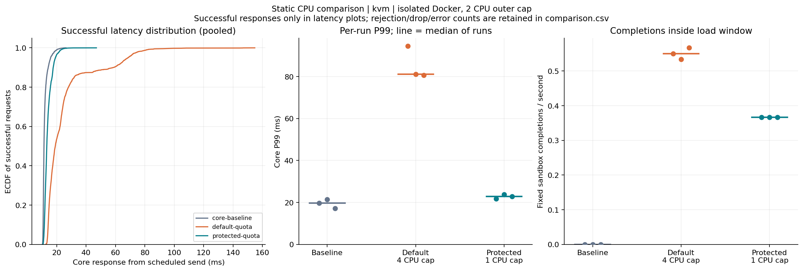

# AgentBox

面向 AI Agent 的轻量代码执行沙箱。使用 gVisor 隔离不可信 Python 代码，并用 cgroups v2 限制资源。完整设计见 [DESIGN.md](DESIGN.md)。

## 当前范围

支持冷启动和一次性预热池两种执行模式：HTTP 请求、runsc 生命周期、输出上限、执行超时、取消、资源限制，以及任务结束后的完整销毁。预热模式提供有界 FIFO 队列、后台补池、总实例容量约束和关闭恢复。单机 QoS 支持 CPU AIMD、压力准入和补池暂停/恢复；动态库存、动态并发、独立 Gateway、MCP 和多节点尚未实现，没有固定时延承诺。详见 [预热池设计](docs/warm-pool.md) 和 [压力 QoS 调度](docs/qos-scheduling.md)。

单次执行与固定 systemd 部署的历史验证见 [第一阶段验收记录](docs/phase1-validation.md) 和 [systemd 部署与验收](docs/systemd-deployment.md)。预热池及关闭修复的最新结果见 [预热池验收记录](docs/warm-pool-validation.md)，与本机原有 cold 服务的验收分别记录。

本阶段由 daemon 直接提供本机 HTTP 接口，后续 Gateway 接入时复用执行协议。

已实现 QoS 观察模式：采集宿主、沙箱父级与受保护服务的 PSI/cgroup 数据，配套固定工作量 Mock Core 和 CSV/JSONL 记录器。默认关闭，观察模式不修改配额。配置、独立容器验收与数据口径见 [QoS 观察说明](docs/qos-observation.md)。

CPU QoS 闭环可使用 `-qos=observe -qos-cpu-control` 预演，或 `-qos=enforce` 写入沙箱父级 CPU 配额；包含上下界、滞回、动作间隔、恢复、写入确认和失败降级。参数、部署与功能验收见 [CPU QoS 说明](docs/cpu-qos.md)。

另加 `-qos-scheduling` 可预演或执行压力准入与补池门控。临时高压返回 `503 qos_pressure`，在途任务继续；稳定低压后恢复，见 [调度规则](docs/qos-scheduling.md)。

观测补充覆盖 manager、可见祖先、低频 I/O/PID、分类创建与排队耗时、拒绝原因和清理阶段；已有实验可离线重算业务延迟与池供给图。新增字段及统计边界见 [观测链路说明](docs/observability.md)。

如何从业务异常逐步定位到等待阶段、供给约束和资源争用，见[六阶段观测系统总览](docs/observability-system.md)。

静态 CPU 对照实验比较无沙箱基线、默认配额和较低配额，记录核心服务延迟与固定沙箱任务完成率，并生成 PNG/SVG 图表。运行方式与统计口径见 [实验说明](docs/static-cpu-experiment.md)。

三轮 KVM 对照已完成，实际结果、实验边界与失败批次排查见 [验收记录](docs/static-cpu-validation.md)。



## 本地开发与检查

需要 Linux、Go 1.25+。Go 代码只使用标准库。依赖准备和容器验收另需 Docker、curl、tar、bzip2、Python 3；KVM 验收还需可访问的 `/dev/kvm`。

```bash
make build
make check
```

准备项目本地依赖（下载 runsc，拉取并导出可信 Python 镜像）：

```bash
bash scripts/install-runsc.sh
bash scripts/prepare-rootfs.sh
./bin/agentboxd -doctor -runsc .local/gvisor/runsc -platform kvm
```

下载脚本默认固定 runsc `20261005.0`，校验官方 SHA-512，保留 runsc 与 sidecar 布局，不修改系统二进制或 Docker runtime 配置。`.local/gvisor/VERSION.txt`、`SOURCE.txt`、`ARCHIVE.sha512` 和 `.local/rootfs-image.json` 记录实际依赖。复现时给安装脚本传入日期版本，给 rootfs 脚本传入记录的镜像 digest。测试容器使用该记录中的镜像 digest。

rootfs 解压显式保留镜像文件权限，并将根目录和 AgentBox 挂载点设为 `0755`，确保准备者使用 `umask 0077` 时沙箱 UID 1000 仍能访问。权限回归测试随 `make check` 运行，无需 Docker 或 root。

`doctor` 只做读取和 KVM API 探测，不创建沙箱或改 cgroup。当前普通用户没有 CPU 控制器委派时，报告失败是预期行为。实际执行要求 root、独立委派的 cgroup v2 子树、cpu/memory/pids 控制器和可信 rootfs。不会静默降级到 runc、宿主 Python 或没有资源限制的 rootless 模式。

官方参考：[安装](https://gvisor.dev/docs/user_guide/install/)、[OCI](https://gvisor.dev/docs/user_guide/quick_start/oci/)、[平台](https://gvisor.dev/docs/architecture_guide/platforms/)。

## 独立容器内验收

已准备依赖且当前用户可以访问 Docker 时，可在一次性测试容器内运行真实 runsc：

```bash
bash scripts/integration-container.sh kvm
bash scripts/integration-container.sh systrap
```

测试容器明确使用 privileged 模式，以支持 runsc 所需的命名空间和 cgroup 操作。它使用私有 cgroup、PID、网络命名空间；不挂载宿主 cgroup 树、Docker socket 或可写源代码。外层同时限制 CPU、内存和进程数。该环境用于验证功能，不能代替裸机性能基准或生产部署安全评审。

测试使用与 systemd 相同的 `umask 0077`，覆盖真实 HTTP 执行、标准输入输出、UID 1000 的输入文件访问、`__main__` 模块与 pickle、环境隔离、用户异常、退出码 125、死循环、输出洪水、只读根文件系统、禁止网络出口、工作目录隔离、后台子进程、受控 fork、内存 OOM、请求取消、容量拒绝、重启回收，以及清理失败停止接单与重启修复。常规执行后检查 bundle 与 cgroup 残留；故障注入时验证 intent 保留并在重启后清理。

fork 用例验证配置的 rlimit 为 64，并在沙箱内降低到 8 来验证拦截机制，避免先撞到 KVM 内存水位；不宣称已经观测到 64 个进程的精确边界。OOM 用例单独将该次任务的 `memory.high` 提高到硬上限，以区分软水位回收与硬限制 OOM；常规执行保留 384 MiB 的软水位。

也可以在已经配置好的独立运行环境中设置 `AGENTBOX_INTEGRATION=1`、`AGENTBOX_RUNSC`、`AGENTBOX_ROOTFS`、`AGENTBOX_CGROUP_ROOT`、`AGENTBOX_PLATFORM` 后执行 `make integration`。未显式开启时测试跳过，跳过不代表隔离验证通过。

## 裸机启动

生产形态尚未完成；当前只支持受信任本机客户端。服务仅绑定显式 loopback IP，执行接口必须携带至少 32 字符的 Bearer token。

先由普通用户完成构建和项目本地依赖准备，再安装固定服务（需要 sudo）：

```bash
make build
sudo bash scripts/install-systemd.sh
sudo systemctl start agentbox.service
sudo bash scripts/smoke-host.sh
```

安装不会自动启动或设置开机自启；首次生成 `/etc/agentbox.env`（0600），后续保留 token。服务使用 `Type=notify`，在状态回收、cgroup 初始化和 HTTP 监听完成后才报告就绪。默认 KVM；首次安装可显式选择 `--platform systrap`。完整配置、更新、回退、卸载及状态保留规则见 [部署说明](docs/systemd-deployment.md)。API token 不进入 runsc 或用户代码的环境。

需要验证执行中停止和崩溃恢复时，显式运行生命周期检查（会启停服务，并 SIGKILL daemon 主进程）：

```bash
mkdir -p artifacts
sudo bash scripts/smoke-host.sh --lifecycle --output "$PWD/artifacts/host-systemd.json"
```

停止服务：

```bash
sudo systemctl stop agentbox.service
```

## 接口与资源语义

- `GET /healthz`：进程存活。
- `GET /readyz`：引擎是否健康、已准备且未关闭；当前容量和 QoS 接单门控另见状态接口及执行请求的 503 原因。
- `POST /v1/execute`：鉴权、校验后同步执行。
- `GET /v1/status`：鉴权后查看模式和预热池/队列状态，观察模式下还包含资源采样与有效性信息。
- 并发默认 1，可配置为 1～4；cold 满载立即返回 503，warm 使用有数量、字节和等待时间上限的 FIFO 队列。
- 每个任务独占全新沙箱，用后销毁；cold 在请求到达后创建，warm 提前创建。任务执行后不归还池、不复用工作目录。
- 实例内保留待命 init，用户任务通过附着式 `runsc exec` 执行并收集退出码，避免短任务在独立 wait 连接前退出；任务完成后销毁整个实例。
- Python 使用 isolated 模式、UID/GID 1000、空 capabilities 和 `no_new_privs`。
- 根文件系统只读；`/workspace` 和 `/tmp` 各 64 MiB，禁止外网。
- 每个沙箱限制为 1 CPU 等效带宽、512 MiB 内存硬上限、384 MiB high、无 swap；宿主任务数限制 256，沙箱内 `RLIMIT_NPROC` 64，二者口径不同。
- 沙箱父级上限为 4 CPU 等效带宽和 4 GiB 内存。
- 代码与标准输入分别最多 256 KiB，输出合计最多 1 MiB。
- `env` 最多 16 项，仅允许 `AGENT_` 前缀和大写字母、数字、下划线构成的键，值不超过 4096 字节且不含 NUL。
- `timeout_ms` 默认 5000、上限 30000，覆盖任务启动和等待；创建运行环境单独最多 10 秒，warm 排队默认最多 100ms，领取后状态检查最多 1 秒，清理命令预算 5 秒，另预留命令退出和输出回收时间。响应分别报告排队、准备、执行、清理与总耗时。
- 成功、代码异常、超时、OOM、取消、输出超限以结构化执行结果表示；基础设施故障返回 500，满载或降级返回 503。
- 收到客户端取消或服务关闭时，使用独立清理上下文回收资源；已开始的 create/start 在其独立 10 秒预算内完成当前操作，再销毁，避免半写的 runsc 元数据。空闲库存最多四路并行清理。
- 清理失败保留 intent 记录、停止接单；重启时仅对本状态目录记录的实例执行回收。
- 请求 ID 当前仅用于关联日志和响应，尚无去重或重试保证；客户端不得自动重放不确定结果。

CPU 和内存统计覆盖单个沙箱 cgroup 的完整生命周期，包括运行时创建和预热空闲期；不是仅 Python 进程的用量。宿主 CLI 开销不包含在该统计内。

## 预热模式与冷暖对比

默认 cold；固定服务在更新 unit 后可在 `/etc/agentbox.env` 中设置 `AGENTBOX_MODE=warm`。warm 预先启动等待实例，任务仍通过新 Python 进程执行，当前不预加载任务解释器。

```bash
bash scripts/integration-systemd-container.sh kvm warm
bash scripts/benchmark-container.sh kvm 60 10
```

基准在独立容器内顺序比较 cold/warm 的库存充足、突发和持续负载，输出逐请求 CSV 与环境/汇总 JSON。已执行的环境与结果见 [预热池验收记录](docs/warm-pool-validation.md)。容器数据不能代替裸机性能结果。配置、时延口径和宿主验收步骤见 [预热池文档](docs/warm-pool.md)。
