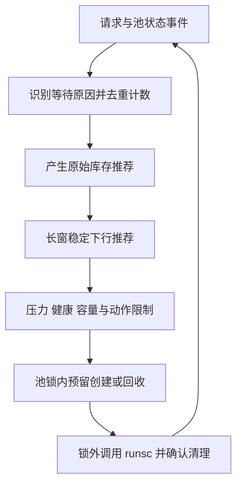

# 库存控制 v2：开源实现对照与学习设计

日期：2026-10-20。当前动态库存实现的两个扩容误判见[理论复核](dynamic-inventory-theory.md)。本页记录源码研究及适配设计。当前 diff 已实现 A/B：阻塞归因、短窗与推荐稳定、可解释状态和安全回收；C 的可选令牌桶仍按需后续接入。源码研究本身没有部署上游项目；当前行为与验证边界见[实现说明](dynamic-inventory.md)。

目标：让每次扩缩容都能说明“缺的是什么资源、依据是什么、受到什么约束”。沿用现有一次性沙箱、FIFO、固定执行并发和总容量，替换当前过于宽泛的 Demand 信号。

## 1. 值得学习的四个开源实现

以下均为仓库源码阅读，不将 Issue 中的提议视为已实现功能。master/main 链接是本次检索时可读的分支快照，会随项目演进；Kubernetes 选择 v1.36.0。未运行这些项目，也不把它们的性能数字用于 AgentBox。

| 项目与入口 | 实际机制 | 适合借鉴的部分与边界 |
| --- | --- | --- |
| [Apache OpenWhisk · ContainerPool.scala](https://github.com/apache/openwhisk/blob/master/core/invoker/src/main/scala/org/apache/openwhisk/core/containerpool/ContainerPool.scala) | `adjustPrewarmedContainer` 区分普通补货与周期调整；`increasePrewarms` 计入已预热和启动中实例；`getReactiveCold` 根据窗口内 cold-start 计数、threshold/increment 和 min/max 给出需求。预热实例还可按 TTL 回收。 | 重点是把正常消费补货和缺货反馈分开。AgentBox warm 不回退冷启动，应以真实库存阻塞替代 cold-start 信号；不能照搬其任务容器复用语义。 |
| [Knative Serving · autoscaler.go](https://github.com/knative/serving/blob/main/pkg/autoscaler/scaling/autoscaler.go) | `Scale` 读取 stable/panic 两个窗口，分别计算期望服务副本数；panic 状态只增加规模，延后降低；可配置延迟窗口，数据不可用时返回无有效建议。 | 学习快响应与慢回收、缺测不作低需求判断。它调服务副本，AgentBox 调 READY，不能把其并发量除以目标值的副本公式直接当库存公式。 |
| [Kubernetes HPA · horizontal.go，v1.36.0](https://github.com/kubernetes/kubernetes/blob/v1.36.0/pkg/controller/podautoscaler/horizontal.go) | `stabilizeRecommendationWithBehaviors` 从历史原始推荐值求稳定范围；下行取窗口内最大值。之后 `convertDesiredReplicasWithBehaviorRate` 另行施加动作速率及 min/max。 | 将原始建议、稳定化和执行限制分层。窗口应记录未经动作限速的推荐，避免把“当前仍保持较高目标”反复写回，导致永不缩容。 |
| [kubernetes-sigs/agent-sandbox · sandboxwarmpool_controller.go](https://github.com/kubernetes-sigs/agent-sandbox/blob/main/extensions/controllers/sandboxwarmpool_controller.go) | `reconcilePool` 按声明目标与实际池成员对账，区分 Ready、未 Ready、终止中；创建会计入仍存在的终止成员。`takeRefillTokens` 用每池令牌桶控制替代创建的发起速率；还存在批处理与缓存变更确认机制。 | 最接近沙箱供给层。借鉴目标与供给分离、在途容量和限速补池。AgentBox 没有 Kubernetes informer，不需要照搬缓存 expectations；最多 8 实例也无需引入其大批量并行创建。 |

本次还交叉阅读了 [OpenWhisk 调度测试](https://github.com/apache/openwhisk/blob/master/tests/src/test/scala/org/apache/openwhisk/core/containerpool/test/ContainerPoolTests.scala)，确认其测试涉及容器复用及容量等待。这些语义与 AgentBox 的一次性销毁有差别，不能整体移植。

## 2. 机制分成四层



这是一套针对 AgentBox 的适配设计，下面的触发规则、数据结构和参数安排不是任何一个上游项目的原样算法。A/B 已落地，不表示已经证明性能收益。

### 第一层：识别真实阻塞原因

令 R=READY 数、I=创建中数量、E=已领取执行名额数、C=执行名额上限。FIFO 队首在每次重新检查调度条件时，按以下原因归类：

| 状态 | 解释 | 对扩容的影响 |
| --- | --- | --- |
| E<C 且 R>0 | 可以分配 | 消费后按原目标补货，不产生增加目标的信号。 |
| E=C 且 R>0 | 只缺执行名额 | 记录 slot_wait，不提高库存目标。 |
| E<C 且 R=0 | 真正等待 READY | 记录 inventory_wait；同一排队者首次进入该状态时产生一次缺货事件。 |
| E=C 且 R=0 | 两种资源同时不足 | 记录 both_wait，先不归因为单独库存瓶颈；名额释放后若仍无 READY，再确认库存事件。 |
| 资源未回收导致总量到顶 | 容量/清理约束 | 暴露 capacity_limited，不能靠增加目标绕过总量上限。 |
| 压力关闭、池关闭或失效 | 准入保护 | 沿用原有拒绝和恢复规则，不计为库存需求。 |

原因随状态转换更新，而非只在入口判断一次；一次排队可能先等名额、再等库存。事件必须在持有池锁、检查真实状态时记录，不能靠 HTTP 轮询推断，也不能每次唤醒重复计数。使用内部排队者身份去重，不依赖可重复的 request_id。

这会直接修正现有反例：有 READY 的名额排队不会触发扩容；每 10 秒一次、补池及时的正常消费也不会积累扩容需求。

### 第二层：短窗决定是否提高目标

初版采用缺货反馈，而不新增到达率预测模型：

1. 保留一个有界短窗，记录新确认的缺货事件和 READY 的最小值；queue_ms 仍记录总排队时间，按原因精确拆分等待时长尚未单列。
2. 有新的真实库存等待，且健康/压力/容量允许时，原始建议提高一档，受最大目标约束。一次事件至多驱动一次上调；冷却期间合并事件，不逐个累加目标。
3. 正常消费只调用原有补货通知。即使领取后 R+I 暂时低于目标，也不直接提高目标。
4. 当前只公开真实缺货与 creating 等状态，不用瞬时忙碌认定持续产能瓶颈。refill_limited 需要后续结合创建时长与持续占用证据再实现；首版不自动提高创建并发。

缺货计数阈值可以保留为一个简单策略参数；初版优先验证“一次真实阻塞才有资格触发、重复唤醒不放大”。短窗长度与上行动作间隔需明确区分；不能把 1 秒冷却解释为能挽救 100ms 排队期限内的当前突发。

### 第三层：用持续未消费的余量判断缩容

现有“必须整池连续无任务”会被低频请求反复打断。新的依据是：最近是否一直有没用到的备用余量，而不是服务是否完全没有请求。

- 在领取完成、创建完成、回收预留等状态变化后更新 READY 最小值；只在定时采样中读取可能漏掉短暂耗尽。
- 有有效短窗、没有新的库存阻塞且窗内 READY 最小值至少为 1，可以给出降低一档的原始建议；否则维持目标。该条件是保守的未消费余量判断，不是最优库存证明。
- 对原始建议使用较长的缩容稳定窗口，取该窗口内的最大值。持续得到较低建议后才下调，每次最多一步。
- 回收仍仅针对超出新目标的 READY。可以保留正在执行的任务并回收多余备用实例；若 FIFO 请求当前可立即分配，先让调度领取。已领取实例永远不参与缩容。
- 缺测、异常时间间隔、压力暂停期间不产生低需求建议；恢复后重建有效窗口，并以当前目标播种历史，防止刚恢复就立即缩到最小值。

因此，即便每 10 秒有一次请求，只要备用库存一直多出一档，也可以逐步回收；不需要等待完全没有请求的 30 秒。

### 学习亮点：滑动窗口最大值可以用单调队列

HPA 使用历史推荐求窗口最大值。AgentBox 可以自行选择单调队列实现这个操作，并不声称上游使用了同一数据结构：

```text
收到 (time, rawTarget)：
    删除队首已经超过稳定窗口的记录
    删除队尾所有 target <= rawTarget 的记录
    把新记录加入队尾
    队首 target 就是窗口最大推荐
```

记录时间递增，目标值严格递减。较晚且不低的推荐，可以完全替代较早的较低推荐；每个记录最多入队、出队一次，更新的摊还时间为 O(1)。由于原始推荐先限制为 1～8 的整数，队列最多保存 8 条记录。无需按“窗口时长 / 采样间隔”保存所有重复样本。

这里只存原始推荐。若把稳定化后仍维持的高目标当成新的原始推荐写回，会不断刷新高值的时间，导致无法下调。

### 第四层：限制实际补货节奏

目标变大和一次允许创建多少实例是两个决定。沿用现有池锁内预留，令 B=接受的 READY 目标、K=创建并发上限、M=总实例上限、T=含创建与销毁在途的总数：

```text
库存缺口       = max(0, B - R - I)
创建名额余量   = max(0, K - I)
总实例余量     = max(0, M - T)
本次创建许可数 = min(库存缺口, 创建名额余量, 总实例余量, 可用创建令牌数)
```

令牌桶是可选的后续小补丁：令牌按配置速率恢复并设容量上限，每次真正发起创建消耗一个；未发起的预留可退还，已经尝试但失败的创建不立即退还，以免失败重试放大开销。没有令牌时等待下一次恢复，而非空转。

创建并发限制“同时有几个 create”，令牌桶限制“每秒发起几次 create”；两者作用不同。对于单机 1～2 个 worker，优先修正需求信号与稳定窗口，令牌桶按实际需要接入。它保护的是创建开销，不能当作额外算力。

## 3. 让决定可解释

状态中区分原始建议、稳定后建议、实际接受的目标，附原因及被限制的原因。设计中可采用以下原因值；当前 A/B 实际字段与已实现值以[状态接口说明](dynamic-inventory.md#状态接口)为准，refill_limited 等产能诊断仍待后续：

```text
slot_saturated         名额不足，增加 READY 不解决当前等待
inventory_stall       新确认的真实库存阻塞
refill_limited        持续补池产能约束
unused_reserve        存在持续未消费的备用余量
downscale_stabilized  缩容仍受历史较高推荐保护
qos_pressure          压力门控暂停动作
capacity_limited      在途总量不允许新建
cleanup_failed        清理失败，停止接单和补池
```

窗口事件和历史建议有界保存；状态接口只读。保留原有总量、失败与清理统计，避免把“建议扩容”记录成“已经创建成功”。

## 4. 实施状态与验证

| 顺序 | 主要改动 | 必要验证 |
| --- | --- | --- |
| A：已实现信号修正 | scheduler 识别等待原因；删除正常领取和任意入队产生的 Demand；新增每排队者一次的库存阻塞事件。 | 两个既有反例转为不误扩容；一次排队先等名额再等库存；取消/超时与重复唤醒计数正确。 |
| B：已实现稳定目标与回收 | inventory 中拆出纯决策函数，加入短窗余量、长窗推荐最大值和上下行限速；缩容只选 READY，并给可分配请求优先权。 | 突发后不立即回收；低频正常请求不推满；有请求但始终多余的 READY 可缩；单调队列与朴素最大值在固定样例中一致。 |
| C：待按需限制补货速率 | refill 增加可选令牌桶；保留已有创建并发、总量、压力和失败边界。 | 并发上限与速率上限分别生效；失败不无限退还令牌；暂停恢复和关闭无重复预留。 |

每次只运行对应的确定性/race 回归；一组功能完成后运行一次 `make check`，再做一个短真实扩容/执行/缩容用例。没有必要把四个上游系统部署起来，也不把长时间性能对照作为实现前置条件。新机制的性能收益仍需要使用数据支持。

## 5. 源码学习顺序

1. OpenWhisk：从普通补货路径追到周期预热计算，解释为什么正常消费与冷启动计数不同。练习将其 cold-start 概念映射成 AgentBox 的库存阻塞，而非复制容器复用。
2. HPA：先读稳定化，再读动作速率限制。用输入推荐 `1,3,1,1` 手算窗口最大值，再写一个单调队列，与逐项扫描结果核对。
3. Knative：追踪 stable/panic 输入、缺测返回与禁止下行的状态。思考“快速看见突发”和“立刻销毁资源”为什么需要不同时间尺度。
4. agent-sandbox：追踪目标、Ready、未 Ready、终止中和创建许可；最后阅读令牌桶。练习解释“并发两个 create”和“每秒两个 create”的区别。

这套机制的学习价值在于把排队分析、反馈控制、滑动窗口算法和资源生命周期放进同一条可解释链路；它是成熟模式的适配组合，不作为新算法或已验证的最优策略宣传。
