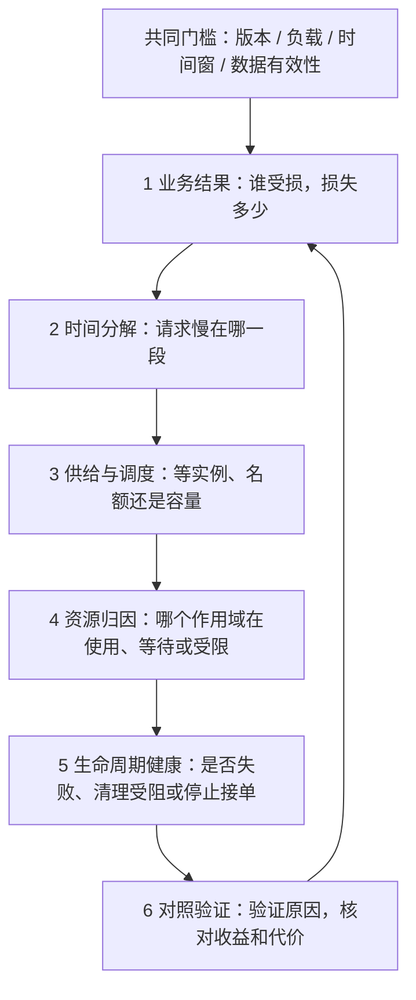

# AgentBox 观测系统总览

这份文档把现有指标组织成六个诊断阶段：**业务结果 → 时间分解 → 供给与调度 → 资源归因 → 生命周期健康 → 对照验证**。指标应持续、并行采集，阶段表示阅读和推理顺序，不表示代码里的六段串行执行。每个阶段都受数据有效性检查约束。

当前业务目标是：在受保护服务的延迟与错误要求、沙箱隔离及清理约束均满足时，提高成功且完成清理的任务完成率，并控制任务等待。受保护服务目前用固定工作量的 Mock Core 模拟，尚未定义生产 SLO；CPU 控制和压力准入/补池门控已接入，自动诊断、告警与动态库存仍待实现，见 [QoS 调度](qos-scheduling.md)。

字段细节见[观测说明](observability.md)，方法依据见[性能理论](performance-theory.md)，本轮实际验证范围见[验收记录](observability-validation.md)。

发现基础设施错误或清理失败时，直接转入阶段五，先处理正确性；不必机械走完前面的性能分析。

## 共同门槛：先判断这份数据能回答什么

| 检查项 | 现有证据 | 不满足时的处理 |
| --- | --- | --- |
| 版本和环境一致 | 内核、runsc/rootfs、程序与脚本哈希、平台、各层资源限制、存储条件 | 分开报告；不能将旧版本成绩当作新版本验收 |
| 负载一致 | Core iterations/checksum，沙箱固定工作量和输出校验，客户端数与计划速率 | 不能把工作量改变解释成拥塞或优化收益 |
| 时间边界一致 | 热身、正式负载窗口、停止提交、drain；采样时间和实际间隔 | 窗口内完成率排除窗口外完成；逐请求耗时可以保留 drain |
| 采样有效 | available、baseline、stale、interval_ms、age_ms、read_ms、collection_ms | 原始状态仍可诊断；无效差分留空，不补零 |
| 没有重复样本 | qos.sequence、各来源 sampled_at；辅助数据自己的 sampled_at | 去重后再计算资源/事件增量；HTTP 查询帧不是独立采样 |
| 生命周期正常 | readiness、基础设施错误、cleanup_complete、残留检查 | 故障批次用于诊断，不能作为有效保护对照 |

CPU/内存默认约 100ms 一轮；辅助 I/O/PID 约一秒刷新一次；请求和清理事件按实际发生记录。读取是顺序操作，不是跨文件原子快照。不能根据一秒刷新数据证明几十毫秒的故障过程，也不能从很短窗口的少量请求宣称稳定 P99。

`qos.state=degraded` 表示观测来源有问题，执行器仍可能 ready；`ready=false` 表示不可接单。两者需要分别处理。HTTP 不可访问时也不能自动认定服务进程已退出，应继续查启动日志和进程状态。

## 阶段一：业务结果——是否发生了业务损失

同时观察受保护业务和沙箱任务，两者缺一会产生错误优化目标。

| 对象 | 指标与来源 | 可以确认的问题 |
| --- | --- | --- |
| Mock Core | 记录器的 offered、成功、503、客户端丢弃、其他错误；延迟分布 | 受保护业务是否变慢、失败或因压测端容量而没有真正发出请求 |
| 沙箱任务 | CSV/响应的 HTTP 状态、任务 status、cleanup_complete、完成时间 | 成功产出、代码失败、超时、OOM、取消、输出超限、拒绝及基础设施故障 |
| 有效完成率 | 固定窗口内 succeeded 且 cleanup_complete 的完成数 / 窗口秒数 | 实际完成并回收的任务产出是否下降 |
| 接单能力 | readyz、状态 ready、qos.scheduling.admission_open、503 reason | 区分健康、临时压力门控和容量/排队约束 |

**HTTP 200 不等于用户代码成功。**代码异常、超时和 OOM 等可以通过 HTTP 200 的结构化任务结果返回。实验中的 hog 用例预期 timeout，证明限制和回收生效；它不能按成功计算任务计入业务吞吐。

当前这些业务统计主要由实验客户端离线汇总。daemon 尚无覆盖所有请求的统一服务端业务计数器；鉴权失败、校验失败、断连和没有响应的执行，不能只靠完成日志完整统计。沙箱客户端采用闭环提交，完成后才发下一次，因此当前任务提交率也不是独立设定的外部到达率。

诊断例：成功请求 P99 降低，同时拒绝数增加或有效完成率下降，只能确认成功请求变快了，还需要评价请求损失；Core 恢复、沙箱完成数归零、ready=false 时，应优先怀疑负载因故障停止。

## 阶段二：时间分解——用户的等待花在哪里

| 时间指标 | 测量边界 | 可以定位的问题 |
| --- | --- | --- |
| Core scheduled_wall_ms | 计划发送到响应完成 | 含客户端发送滞后的整体等待 |
| Core wall_ms | 实际开始 HTTP 调用到响应完成 | 客户端请求调用及服务端响应链路 |
| Core work_ms | 服务端固定计算开始到结束 | 工作处理区间变慢；仍包含该区间的调度/资源等待 |
| Core 发送滞后 | started_ms − scheduled_ms | 负载生成器未跟上计划，可能受自身调度、预算等影响 |
| 沙箱 queue_ms | warm 领取调用的经过时间 | 领取实例/名额之前的等待与调度路径开销 |
| setup_ms | cold 创建并准备任务；warm 检查实例并准备输入 | 冷创建或领取后的状态检查、文件准备变慢 |
| execution_ms | runsc exec 启动到等待退出 | 启动 Python、用户执行、运行时及资源等待这一整段变慢 |
| cleanup_ms / total_ms | 执行后收尾 / Engine 本次流程 | 销毁对响应和名额占用的影响；Engine 内部总等待 |

warm 的后台创建耗时不在本次 setup 中，转阶段三看；cold 与 warm 的 setup 含义不同，应分组。响应 queue_ms 包括立即领取时的少量决策开销，队列驻留直方图只包含真实入队者，两者人口不同。

Engine total_ms 不覆盖前面的完整 HTTP 鉴权、读取和解码，也不覆盖后面的全部响应编码/传输。沙箱客户端目前记录 wall_ms，没有与 Core 相同的计划到达延迟。单独的 HTTP/解码/网络阶段尚未埋点。

只能用同一请求的时间边界做分解；不能相加独立阶段 P99，也不能用两个 P99 相减来分配责任。execution_ms 变大可以定位到区间，不能直接确认为 Python 算法慢。

## 阶段三：供给与调度——为什么请求拿不到运行环境

这层观察的是软件资源，与 CPU、内存同样需要区分占用、等待和失败。

| 软件资源 | 使用/容量指标 | 等待/失败指标 | 主要作用 |
| --- | --- | --- | --- |
| READY 库存 | idle、target | idle 持续为零及队列增长 | 缓冲突发；不等于持续创建产能 |
| 创建 worker | creating、creation_limit、creation_attempts | 成功/失败/中止耗时与计数 | 解释后台供给速度和不成功的创建成本 |
| 执行名额 | execution_in_flight、execution_limit | 排队耗时与最老等待 | 名额从领取占用到收尾后释放，不只覆盖 running |
| 总实例容量 | total、max_sandboxes；creating/idle/leased/running/destroying | 总量长期到顶、销毁堆积 | 容量包括正在创建和销毁的实例 |
| FIFO 队列 | queued、queued_bytes 及对应上限 | assigned/canceled/timed_out/unavailable 驻留分布；count_full/bytes_full | 确认积压、超时、取消与入队前拒绝 |

可用的观测组合：

| 组合 | 能直接确认 | 首选假设与验证 |
| --- | --- | --- |
| idle=0，creating 接近上限，名额未满且队列增长 | 请求缺少可领取实例 | 创建供给不足；固定其他条件测试创建并发，并观察创建率和 Core 代价 |
| idle>0，名额已满且队列增长 | 空闲实例存在，但当前名额约束阻止领取 | 拆分在途任务耗时，检查执行或收尾；增加库存未必有帮助 |
| total 到顶，destroying 持续较高 | 清理中的实例仍占容量 | 查看清理阶段，先处理销毁等待 |
| queue_count_full | 达到队列数量边界而拒绝 | 需结合负载与供给判断；不能直接断定 CPU 不够 |
| queue_bytes_full，数量未满 | 达到队列文本预算而拒绝 | 检查请求体大小和等待；不应只扩大队列数量 |
| timed_out/canceled 增多 | 排队者在领取前流失 | 对照排队预算、客户端取消和供给；不能只报告获分配请求的等待 |

创建成功、失败、中止分别使用自己的 count 与 total_ms；所有真实入队结果都纳入驻留统计。旧 creation_total_ms 与 creation_count 不能直接相除。新直方图是固定非累计桶，只提供分布范围，精确 P99 仍需逐事件数据。

累计计数在同一进程和有效时间窗内差分才成为速率。观测创建率不是最大产能；窗口端点的在途实例和初始库存使它与完成率可能不同。Little 定律只可在边界、人口与时间窗一致的近似稳定区间交叉核对，不把 offered rate 与只成功排队者的平均等待混用。

## 阶段四：资源归因——是谁在消耗、等待或受约束

先在同一时间窗比较 `protected`、`sandboxes`、`manager` 与可见祖先，再用 `host` PSI 看系统背景。角色与路径必须一起保存：祖先包含后代，manager 可能与某个祖先重合，各层不能直接相加。私有命名空间以外的祖先不可见。

| 资源 | 使用与上限 | 等待、限制或事件 | 能确认与不能确认的内容 |
| --- | --- | --- | --- |
| CPU | usage/user/system 增量，核等效用量，cpu.max 的 quota/period | CPU PSI；节流周期与时间增量 | 有实际消耗、等待或配额限制；PSI 本身不指认竞争者，节流比例不是业务延迟比例 |
| 内存 | current、high、max；任务 Usage 的 peak | memory PSI，high/max/oom/oom_kill 事件增量 | 水位事件、等待和 OOM；无 OOM 不排除回收造成的延迟 |
| I/O | 每设备累计字节和次数，带独立时间戳 | I/O PSI some/full | 观察到 I/O 相关等待；没有设备 await、文件路径和线程等待栈，不能断言哪个文件/库是根因 |
| PID | current、max | 累计限额命中及增量 | 宿主 cgroup 的任务数量和限额命中；不是沙箱内 Python 进程数，也不能独自证明 RLIMIT_NPROC 边界 |

CPU 核等效用量可以大于 1；quota 是带宽上限，不是预留或独占。memory high/max 是限额，不能当作已经分配的 RSS。PID、内存和 CPU 的约束也可能来自祖先。

任务 Usage 在删除 cgroup 前读取，包含读数之前的创建、预热空闲和执行成本；不等于纯 Python 用量，也不覆盖读数之后的全部清理成本。manager/父级曲线可补充不同作用域的成本，不能把某个近似生命周期用量当作某一执行阶段的 CPU 需求。

典型判断：

- Core 变慢、protected CPU PSI 增加、共同祖先节流增加：支持存在调度/预算争用；仍需对照验证沙箱的具体贡献。
- 沙箱自身节流低、祖先节流高：可以确认子级统计不足以排除上级带宽限制。
- memory.high 事件和 memory PSI 增加，任务延迟升高但无 OOM：优先验证回收/软限额路径，而不是认定内存正常。
- 创建变慢、I/O PSI 增加：形成 I/O 等待候选；需要运行时日志或独立存储对照，不能仅凭相关曲线确定因果。

## 阶段五：生命周期健康——是否还能正确地继续执行

| 指标/证据 | 能确认的问题 | 边界 |
| --- | --- | --- |
| healthz 与 readyz | 存活和可接单状态 | alive 不保证 ready；ready 不保证立即有空闲名额 |
| HTTP 500、基础设施日志 | 实例创建、运行时操作或资源管理等基础设施失败 | 不与用户代码非零退出混为一类 |
| cleanup_complete、cleanup_failures、destroying | 回收是否确认成功，失败是否占住库存 | 失败记录保留是恢复线索，不应通过丢弃它们美化吞吐 |
| cleanup.active/recent 与任务 cleanup_phases | 操作停在 runtime_delete、cgroup_kill、cgroup_empty_and_remove、output_readers 或 bundle_remove | 定位到操作阶段，尚无线程/内核等待栈；部分阶段未执行时不会伪造成功记录 |
| intent/bundle/cgroup 残留检查、启动回收与关闭测试 | 退出后资源和记录能否回收，重启能否继续服务 | 目前主要由集成测试/验收脚本检查，不是持续的残留监控指标 |

输出读取阶段目前记录的是 finishStreams 调用的完成时间，没有独立的“自然 EOF/强制关闭”结果分类。清理历史最多保留 64 个已结束阶段，dropped 是淘汰数；其缓存随进程退出丢失。HTTP 启动前失败时，无法依靠这个端点查看现场，应从进程、启动和 runsc 日志取证。

如果 Core 延迟下降发生在清理失败、ready=false、沙箱负载消失之后，应将其判为故障后的负载变化，不能作为 QoS 保护收益。

## 阶段六：对照验证——确认假设和可接受的权衡

前五层定位现象和候选原因；本层复用这些指标，改变一个条件，检查预测是否成立。它不是新的资源采集族。

| 待验证问题 | 对照方法 | 必须一起报告 |
| --- | --- | --- |
| 沙箱带宽是否影响 Core | 固定工作量、其余配置和配额周期，改变沙箱父级 quota | Core 延迟/错误、发送滞后、沙箱有效完成率及耗时、资源曲线、清理正确性 |
| 是否是创建供给不足 | 每次只改创建并发或库存等一个因素 | 创建成功率和耗时、idle、队列、名额、Core 延迟与内存成本 |
| 压测端是否改变了结论 | 固定服务器条件，改变生成器资源位置 | 发送滞后、客户端与服务端各时间口径、实际发送/丢弃数 |
| 观察器有多少代价 | 固定业务条件，off/observe 和采样间隔分别对照 | Core/任务结果、manager 成本、采集时间与过期率；记录器成本另计 |
| 动态策略是否更好 | 后续将动态策略与合理静态配置在同样负载变化下比较 | 业务收益、任务代价、动作/配额、恢复时间、抖动和失败行为 |

现有静态实验包含 baseline、默认 quota、较低 quota 三组；默认和保护组对照只改变沙箱父级 quota。baseline 使用 cold 无库存，负载组是 warm，不能称三组间所有差异都只有 quota。

已完成的三轮旧版本 KVM 实验支持特定环境下的保护/吞吐权衡。它尚未证明最佳 quota、动态 AIMD 优于静态策略、裸机容量或所有任务的普遍收益。新采集逻辑只读真实内核测试通过，本轮完整 KVM 短测仍在启动阶段失败，不能将旧实验作为新版本运行时验收。

## 三类指标的共同点与差异

| 类型 | 样本是什么 | 适合回答 | 不能替代 |
| --- | --- | --- | --- |
| 请求/阶段事件 | 一个请求或一次操作 | 结果、逐请求耗时、哪个阶段等待 | 不覆盖没有请求时的空闲和后台全部成本 |
| 状态/累计计数 | 某时刻的库存、队列、名额和累计结果 | 积压、容量约束、窗口速率 | 瞬时状态不能独自给出请求等待分布 |
| 资源采样 | 某作用域在一段实际间隔内的用量与等待 | 资源成本、压力和配额限制 | 不能独自判定业务成功或指认根因 |

共同要求是携带时间、范围、版本和有效性，并使用匹配的人口与分母。任务的 request_id 是可选的客户端关联值，不应当作全局唯一标识；已创建实例用 execution_id/sandbox_id 关联，空闲库存没有任务时只使用 sandbox_id。当前还没有覆盖入口、创建、执行、清理的完整持久化追踪。

## 统一的诊断记录与后续缺口

一次问题记录固定写出：**业务影响 → 同窗有效数据 → 最慢阶段 → 容量/资源证据 → 候选原因 → 一次对照与预测 → 实际收益/代价 → 未解释部分**。

例如：Core 变慢 → 发送滞后和 work_ms 同时变大 → 核对 protected 与祖先的 CPU 等待/节流 → 检查 daemon 未降级、清理正常 → 在固定条件下降低沙箱 quota → 同时报 Core 改善和沙箱完成率损失。由此能确认该条件下的保护权衡；要精确归因客户端和服务端，还需生成器隔离对照。

后续补充按诊断收益排序：

1. 先完成本轮 KVM 端到端验收及启动失败取证，保留失败现场和版本边界。
2. 完整服务端业务计数、进程/运行批次标识与关联日志；补 HTTP 入口和尚未响应任务的可见性。不要把高基数任务 ID 当成聚合指标标签。
3. 采集和记录器开销对照、生成器隔离、quota 扫描；据此再确定业务目标与控制预算。
4. 有证据再加 create/exec 子阶段、持久清理事件、线程等待/FD/内核栈、memory.stat/swap 等诊断；系统级 CPU 用量目前也未采集。
5. 动态控制另加目标预算、建议值、实际值、动作原因、写入失败、冷却和恢复事件，与现有业务/资源指标关联验证。

当前代码已提供这套系统的大部分基础数据与实验工具；CPU 与压力准入/补池门控初版已接入，见 [QoS 调度](qos-scheduling.md)。统一服务端聚合、持续告警、持久追踪和动态库存仍需后续实现。
