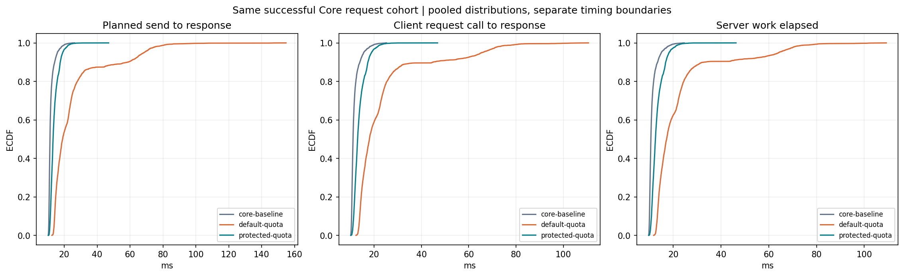
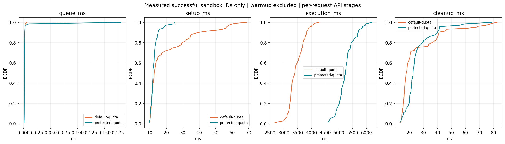
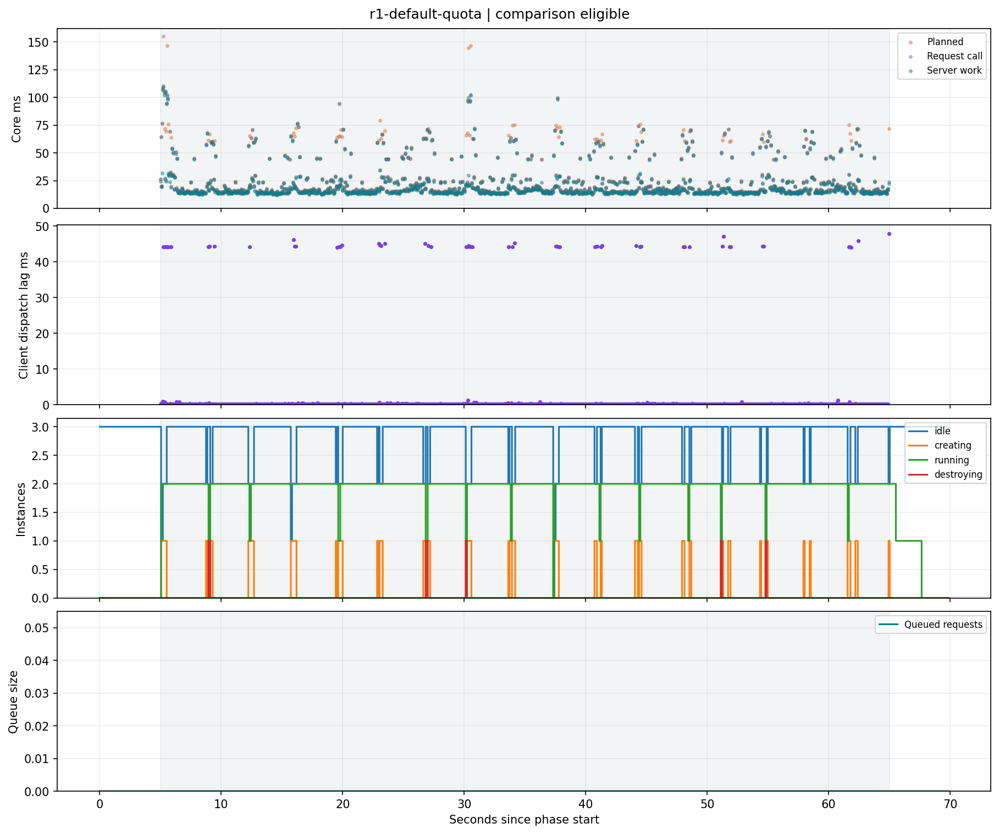

# 观测：从业务结果定位到供给和资源

观察器只读 PSI/cgroup、调度统计和清理事件，HTTP 返回缓存。资源动作由 [QoS 控制器](qos.md)执行。先检查数据是否有效，再判断等待阶段与瓶颈；测量口径与结论见 [验收汇总](validation.md)。

<a id="diagnosis"></a>
## 诊断流程

| 顺序 | 问题 | 证据 |
| --- | --- | --- |
| 1. 业务结果 | 成功、拒绝、超时或客户端丢弃发生了什么？ | offered/成功/拒绝/失败分开统计，禁止仅看成功请求分位数 |
| 2. 时间分解 | 请求在排队、准备、执行还是清理？ | 单请求 timings、客户端计划发送与实际发送时间 |
| 3. 供给约束 | 缺 READY、创建产能还是执行名额？ | idle/creating/execution_in_flight、队首等待原因和库存目标 |
| 4. 资源归因 | 谁在消耗或受约束？ | 同一来源的 CPU、PSI、节流、内存与祖先预算 |
| 5. 生命周期 | 创建和清理能否继续收敛？ | 失败计数、cleanup.active/recent、intent 与就绪状态 |
| 6. 对照 | 变更与业务结果是否有可复现关联？ | 固定其余条件的重复对照，同时报告业务保护与沙箱产出 |

CPU 高使用率不等于饱和，PSI 也不直接证明邻居是根因。更多 READY 不能解除执行名额或长期创建产能限制。计算资源之间、阶段分位数之间都不能简单相加减。完整推导见 [性能理论](performance-theory.md)与[引用索引](performance-theory-references.md)。

<a id="sampling"></a>
## 采样与有效性

`-qos=observe|enforce` 显式配置受保护 cgroup，采样周期默认 100ms、范围 50ms～1s；off 不启动采样。计数器差分使用实际单调时间间隔。

| 来源 | 范围 |
| --- | --- |
| host | `/proc/pressure`，反映宿主背景，不是容器独有压力 |
| sandboxes | 沙箱父级 cgroup |
| protected | 显式指定且与沙箱树分开的服务 cgroup |
| manager | daemon 实际所在组，可能还有其他进程 |
| ancestor_0 等 | 最多八级可见祖先，记录发现边界与原因 |

祖先包含后代，manager 也可能与某祖先重合，不能将用量相加。私有命名空间看不到的祖先不在报告中，不声称采集整个宿主层级。系统级只采 PSI，没有 `/proc/stat` 利用率。

- CPU 核等效用量为 Δusage_usec/实际间隔微秒；可超过 1。PSI 短窗百分比为 100×Δtotal_usec/实际间隔微秒；avg10/60/300 用于趋势。
- 首次/恢复、目录身份变化、计数回退、非正或超过五个采样周期的间隔都重建基线。
- 主快照年龄或采集耗时超过三个周期、或采样停止时为 stale。有效零为 0，缺测与无效差分为 null；系统 CPU full 始终无有效值。
- 每来源有时间戳；sequence 在进程内递增，HTTP 多次轮询可能返回同一采样，不能按查询次数累加事件。
- 原始文件最多 64KiB，读取不是跨文件原子快照。cpu.max 的 max 与数值 0 不混淆；所有速率都需检查来源与窗口有效性。

I/O/PID 每秒刷新一次，独立时间戳、年龄、读耗时和 stale。io.stat 最多 128 个设备，只提供累计次数/字节，不提供 await。辅助数据超过三秒或主快照过期时不报告速率；按辅助 sampled_at 去重。可选文件缺失不会使 CPU/内存失效，也不会为采集额外委派 I/O 控制器。

## 调度与清理字段

- execution_in_flight 包含领取至清理结束；creation_limit/attempts 与成功、失败、中止创建分开，不能用旧 creation_count 和旧 total_ms 混算均值。
- queue_entered 和 assigned/canceled/timed_out/unavailable/pressure_rejected 分开；立即领取不计入队，数量或字节满也不混入排队耗时。
- 耗时直方图为非累计桶，边界为 1、5、10、25、50、100、250、500、1000、5000、10000ms，null 为溢出，不承诺精确分位数。
- 同一池快照满足 attempts=成功+失败+中止+creating，以及入队=各离队分类+queued。跨组件快照并非原子事务。
- 503 包含拒绝 reason，只有实际入队才有 queue_ms。request_id 用于关联，不提供去重。

清理阶段保持顺序：

```text
runtime_delete → cgroup_kill → cgroup_empty_and_remove
               → output_readers → bundle_remove
```

`cleanup.active` 在操作开始时出现；recent 保存最近 64 个结束阶段，dropped 表示淘汰数量。结果 cleanup_phases 包含实例、起止时间、耗时与错误。无法确认外部资源清理时保留 bundle/intent；事件缓存不持久化，也没有自动线程/内核栈抓取。

## 记录与离线分析

```bash
# 启动受控的短观测实验；已有本地依赖后执行。
make build
python3 scripts/container.py observe --platform kvm

# 记录已运行的 observe/enforce 服务；token 从环境读取。
python3 scripts/experiment.py record --output artifacts/observe-manual \
  --duration 30 --rate 20 --sandbox-workers 2

# 读取历史数据，不启动负载；恢复原始数据的方法见 validation.md。
python3 scripts/experiment.py analyze artifacts/static-kvm-XCmQHtIX \
  --output /tmp/agentbox-analysis --no-plots
```

记录器保存逐请求 Core/沙箱 CSV、状态 JSONL、配置和质量摘要。成功、拒绝、客户端丢弃、其他失败分开；enforce 的动作来自 daemon，记录器不修改策略。容器观测为 2 CPU，idle-pool 仍包含库存与观察开销，不能当独占业务基线。

离线分析只写新的输出目录并记录源文件哈希。Core 三种时间口径使用同一窗口、同一批成功请求；沙箱阶段只匹配正式 CSV 中成功且清理完成的 execution_id，排除 warmup。drain 完成请求保留阶段数据，但不计入窗口吞吐。

历史九组数据匹配到 177 个正式任务、无缺失事件。默认组 Core 发送滞后 P99 为 44.51/54.83/12.31ms，服务端 work P99 为 71.39/76.38/77.35ms，说明客户端等待也需单独观察。[分析 JSON](data/observability-analysis.json)保留逐轮数字；旧数据缺少新增 manager、祖先、I/O、PID 等字段，不补写新指标。







ECDF 只是经验分布，不是置信区间。新增采集净开销、长期告警和持久追踪未独立验证；普通磁盘 KVM 观测短测的失败仍作为已知问题保留。内核定义参见 [PSI](https://docs.kernel.org/6.8/accounting/psi.html)和 [cgroups v2](https://docs.kernel.org/6.8/admin-guide/cgroup-v2.html)。
