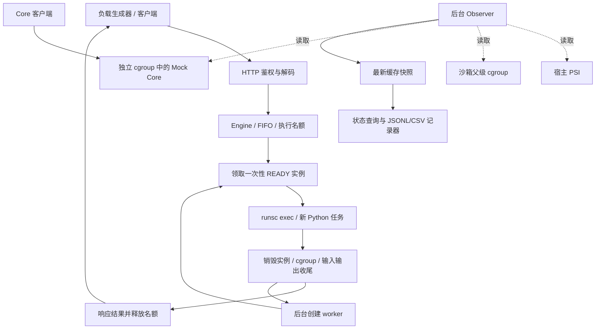

# AgentBox 的性能理论、瓶颈判断与优化验证

日期：2026-10-19。分析对象：当前工作区，HEAD 为 `d4ccb8d`，包含尚未提交的静态 CPU 实验改动。

这份文档把 Brendan Gregg 的《Systems Performance: Enterprise and the Cloud》第 2 版中的方法，映射到 AgentBox 的执行链路、资源范围与已有实验。先读目录，再选读 79 页相关正文，没有通读全书；印刷页与 PDF 页的对应、27 条短引文和源码位置均在[引用索引](performance-theory-references.md)。

引用约定：`Bxx` 是书中原理；`Cxx` 是代码事实；`Exx` 是实验数据；`Kxx` 只补充书中 v1 接口与当前 Linux v2 接口的差异。标为“推论/假设/建议”的句子是本文应用这些原理的结果，不能说成作者对 AgentBox 的直接结论。每条关键论证均附依据；章节标题、符号定义和阅读指引不是书中引文。

本文提供的是一套可以继续补充证据的分析体系，而不是宣称某一指标能够解释所有故障；书中也明确要求记录未观测到的资源、检验测量本身，并用实验验证假设。[B04]、[B10]、[B21]

## 1. 先建立一条完整的判断链

1. **先定义用户关心的结果。**要同时描述 Core 的响应延迟/错误与沙箱的有效完成率，单独追求低 PSI 或高 CPU 利用率不构成项目目标。[B02]、[B05]
2. **画清资源与时间边界。**请求经过客户端、HTTP、排队、实例准备、任务执行、销毁；创建者、控制命令、监控和压测端也消耗资源。[B01]、[B06]、[C01]、[C02]、[C09]
3. **从业务影响出发检查资源。**先看请求率、错误和耗时，再对 CPU、内存、I/O、执行名额、库存及队列应用 USE，而不是看见某条曲线升高就调参数。[B04]、[B05]、[B22]
4. **区分“忙”“等”“被限制”。**高使用率可能是有效工作，PSI 表示资源等待，配额还可能在硬件未满时阻止任务继续运行。[B03]、[B14]、[B16]、[B18]
5. **将等待定位到具体阶段。**先找到哪个阶段变慢，再区分运行中计算、等 CPU、等 I/O、等锁、等实例或等清理；真正无任务的空闲等待不算待优化的请求损失。[B06]、[B13]
6. **用可反驳的预测确认瓶颈。**例如降低沙箱 quota 后，预测 Core 尾延迟下降、沙箱任务更慢；如果观测不支持，就更换假设，而不是继续堆策略。[B21]、[B23]
7. **同时报告收益、代价与适用范围。**当前静态实验支持某个受限环境中的保护/吞吐权衡，不能直接推出裸机容量、所有 Python 工作负载或动态 QoS 的收益。[B09]、[B24]、[E01]

## 2. 当前系统到底在优化什么

### 2.1 架构与资源范围



图表示逻辑关系：cold 路径会在请求期间创建实例；warm 路径提前创建待命实例，领取后执行一次就销毁。warm 的库存补充由创建 worker 完成，不能把执行过的容器重新放回 READY 来换取性能。[C02]、[C03]、[C04]、[C07]

静态实验的资源层级是：外层容器共享 **2 CPU 等效带宽、5 GiB 内存**；其内部包含 Core、daemon/控制命令、沙箱子树与实验控制器。沙箱父级默认上限为 4 CPU 等效带宽，保护组改为 1；单实例为 1 CPU 等效上限。父级 quota 大于外层可用带宽，并不使子树获得额外算力。[C05]、[C10]、[E01]、[K01]

daemon manager 与 runsc 控制 CLI 不计入单个沙箱 Usage；完整测量必须同时观察 manager、沙箱父级、Core 与约束它们的祖先。当前 Observer 只内置 host、sandboxes、protected 三个来源，因此 manager 和外层 cgroup 的持续资源曲线是需要补充的观测范围。[B01]、[B19]、[C04]、[C05]、[C06]、[C10]

### 2.2 目标函数与约束

**建议的目标定义：在 Core 延迟与错误要求、沙箱隔离和清理约束均满足时，提高成功且完成清理的沙箱完成率，并降低合适工作负载的请求延迟。**具体 Core SLO、允许的拒绝率和任务延迟预算应由使用需求确定，不能从当前最好的一次实验反推出“产品承诺”。[B02]、[B05]、[B26]

| 需要回答的问题 | 项目中应使用的指标 | 依据 |
| --- | --- | --- |
| Core 是否受到用户可见影响？ | 计划发送到完成、实际发送到完成、服务端 work_ms 的分布；成功/拒绝/错误/客户端丢弃 | [B05]、[B06]、[C08]、[C09] |
| 沙箱有效产出是否增加？ | 固定测量窗口内成功并清理的任务数 / 窗口秒数 | [B02]、[B24]、[C09] |
| 快的代价是否是拒绝更多请求？ | offered、入队/接纳、成功、超时、拒绝分列，不能只报成功 P99 | [B05]、[B24]、[C01]、[C09] |
| 代价来自哪里？ | queue/setup/execution/cleanup，加后台创建和空闲库存成本 | [B06]、[C02]、[C03] |
| 系统是否真正可继续工作？ | readiness、清理失败、残留实例、计数器与快照有效性 | [B04]、[B10]、[C03]、[C06]、[C11] |

## 3. 时间模型：先证明慢在哪里

### 3.1 单请求的时间账本

根据当前代码，对一条成功返回的请求可建立如下时间分解；这是按实际测量边界建立的模型，不是书中直接给出的 AgentBox 公式。[B06]、[C01]、[C02]、[C09]

```text
R_planned = 计划发送滞后 + R_sent
R_sent ≈ 网络/连接/HTTP 前后处理 + R_engine
R_engine = queue + setup + execution + cleanup + 少量未单列开销
```

`execution_ms` 包括 runsc exec 控制、启动 Python、用户计算、等待退出，不是纯 Python CPU 时间；`cleanup_ms` 位于响应与名额释放之前。warm 的后台预热成本不在本次请求总时延中，却仍真实消耗机器资源。[B06]、[B13]、[C02]、[C04]

**规则 T1：按同一请求的事件时间分解，不把不同请求的阶段 P50/P99 相加。**`P99(A+B)` 一般不等于 `P99(A)+P99(B)`；同理，不能用两个 P99 相减得到某阶段贡献。该规则是对分位数定义和当前逐请求测量的直接应用。[B09]、[C09]、[E03]

**规则 T2：先定位最长部分，再细分它。**若 execution 占数秒、setup 只有十余毫秒，优化 JSON 编码不会解决这个长任务的主要时延；但对另一种短任务，启动或销毁可能成为主导，不能跨工作负载套用结论。[B06]、[B08]、[B22]、[E01]

可用局部优化上限做初筛：某阶段占同一组平均总时间的比例为 `f`，该阶段加速 `k` 倍，其他条件不变时，总体加速约为 `1 / ((1-f)+f/k)`。这是将固定串行时间拆分后的推导，与书中的 Amdahl 思想一致；`f` 应由同一组请求的时间和计算，不能拿独立阶段中位数拼接，且该式不能预测尾延迟或排队反馈。[B06]、[B08]、[B09]

### 3.2 Off-CPU 不都值得消除

池 worker 库存充足时等 `changed`、idle init 等信号，属于无工作时的正常等待；有请求的 worker 在等实例、等 cgroup 变空、等运行时退出，才可能影响任务完成。对所有线程直接做 off-CPU 汇总，会被前一种等待淹没，应按请求阶段、进程角色和时间窗口过滤。[B11]、[B13]、[C03]、[C04]

如果 cleanup 突然变长，应在超时发生期间记录 runsc CLI、运行时进程和相关文件/进程等待路径；CPU 火焰图只能解释当时消耗的 CPU，不能独自解释它为何在等待。侵入式跟踪可用于单独诊断轮次，不能将开销明显不同的诊断结果与正常成绩混报。[B13]、[B25]、[C04]、[E01]

## 4. 预热池模型：库存、产能和名额要分开

### 4.1 代码里的三种约束

当前领取需要同时取得一个 READY 实例和一个执行名额；实例从领取到清理结束一直占名额，创建中和销毁中的资源也占总实例容量。[C02]、[C03]

| 符号 | 当前对应物 | 它能限制什么 |
| --- | --- | --- |
| `B` | `WarmPoolSize`，空闲库存目标 | 已准备好的实例数量，主要缓冲突发 |
| `k` | `CreateConcurrency` | 同时创建实例的 worker 数 |
| `C` | `Concurrency` | 已领取且尚未完成清理的执行名额 |
| `M` | `MaxSandboxes` | 创建、空闲、领取、运行、销毁的总容量 |
| `Q`、`Q_bytes`、`W_max` | 队列数量、文本预算、等待期限 | 控制积压规模和等待，不能直接增加服务产能 |

本表是代码模型，应用的是书中“软件资源也检查使用、等待和错误”的方法。[B04]、[B12]、[C03]

### 4.2 为什么库存大不等于持续吞吐高

在一个全部成功、每实例只执行一次、长时间近似稳定的区间，成功任务持续完成率最终受成功实例补充速度限制；初始库存只能让短时领取数暂时超过同期创建数。warmPool 因此更像一次性物料库存，而不是执行后可以复用的连接池，也不是反复命中的结果缓存。[B07]、[B22]、[B27]、[C03]

下面是用于找假设的**容量上界近似**，不是已经拟合或验证过的预测模型：[B07]、[B08]、[C02]、[C03]

```text
X_success ≲ min(
    k / E[T_create],
    C / E[T_lease],
    M / E[T_instance_lifetime],
    B_cpu_effective / E[D_cpu_per_success]
)
```

- `T_create`：创建 worker 真正执行一次创建所用时间；第一项暂忽略失败、重试、停工等待，实际有效供给可能更低。[C03]
- `T_lease`：从领取到确认收尾的名额占用时间；销毁变慢也会减少产出，不能只计 Python 执行。[C02]、[C03]
- `T_instance_lifetime`：从预留创建容量到确认销毁的全寿命，包括空闲期；第三项只有在同一统计边界、人口近似稳定时才有意义。[B07]、[C03]
- `D_cpu_per_success`：与分母有效 CPU 预算采用相同作用域的平均 CPU 成本；若分母取整个外层容器的预算，分子就不能只统计单个沙箱而漏掉创建、控制器、Core 等工作。[B01]、[B18]、[B19]、[C05]、[C10]

这些量随并发和争用一起变化，不是独立常数；不能从单 worker 的空闲创建时间直接推导高负载下双 worker 的吞吐。[B08]、[B12]、[B17]

在队列的稳定区间可用 Little 定律 `平均排队人数 = 实际入队率 × 平均排队时间` 交叉检查。实际入队率应排除入队前拒绝，但统计中应包含随后取消/到期的排队者及其驻留时间，不能把全体 offered rate 与仅成功请求的 queue_ms 混用。[B07]、[C03]

本项目还有 FIFO、超时、有限队列、有限库存、共享 cgroup 配额与补池过程，不能未经验证就套用 M/M/1 或书中磁盘 M/D/1 的“60%”示例来定 CPU 阈值。[B07]、[B14]、[C03]

### 4.3 库存问题的可检验预测

| 观测组合 | 首选假设 | 要验证的变化 | 依据 |
| --- | --- | --- | --- |
| idle 持续为 0，creating 接近 k，executing 尚未到 C | 补池供给不足 | 固定其余条件，将 k 从 1 改到 2；看创建率、队列、Core 延迟是否一起变化 | [B04]、[B21]、[C03] |
| idle 为 0，total 持续为 M，destroying 较高 | 总容量被收尾占用 | 拆分 destroy 耗时；不要仅增大库存目标 | [B06]、[C02]、[C03] |
| idle 大于 0，executing 已达 C，队列增长 | 执行名额/服务时间约束 | 分解已领取任务的时间；只改 B 预计不会解除瓶颈 | [B04]、[B07]、[C03] |
| 改大 B 后突发更好，长时间完成率不变 | 库存只吸收了突发 | 延长稳态窗口并量化创建率，不宣称容量同比增加 | [B07]、[B22]、[B26]、[C03] |

## 5. 资源争用模型：使用率、压力、配额、业务影响

### 5.1 CPU 的四张账

1. **实际消耗**：`Δusage_usec / Δwall_usec` 是 CPU 核等效用量，可能大于 1；其统计对象是整个资源组，不是某一条 Python 语句。[B14]、[B19]、[C05]、[C06]
2. **局部额度**：当 `cpu.max = quota period` 时，`quota/period` 是等效 CPU 带宽上限；不是 CPU 绑定、资源预留或有效吞吐保证。[B18]、[C05]、[K01]
3. **等待与限速**：CPU PSI、`Δnr_throttled`、`Δthrottled_usec` 分别提供等待和限速线索；`Δnr_throttled/Δnr_periods` 是发生限速的周期比例，不是业务慢了多少百分比。[B04]、[B14]、[B19]、[C06]、[C11]
4. **业务效果**：必须同时看 Core 延迟、错误/拒绝与沙箱有效完成率。低 PSI 可能只是没有执行工作，不能代替业务收益。[B02]、[B05]、[B24]、[C09]、[C11]

在本次静态实验中，沙箱父级默认允许 4 CPU，但它与 Core、manager、压测端共同位于外层 2 CPU 上限下，因此沙箱父级本身节流不高，也不能排除外层限速或竞争。把沙箱上限改成 1 CPU，可以给其他工作留下更多共享预算空间，但并不为 Core 保留独占核。[B18]、[B19]、[C10]、[E01]、[K01]

高 CPU 使用率还可能包含内存访问停顿，SMT 逻辑线程也不等价于独立物理核；若算力效率异常而调度证据不足，再查 IPC、缓存、内存带宽、频率和线程放置。当前 PSI 和 cgroup 数据不能独自证明这些微架构原因。[B14]、[B04]、[C06]

### 5.2 PSI 的位置与边界

PSI 是 Pressure Stall Information；书中将其放在 CPU、内存、I/O 饱和观测中，并说明既有系统级也有 cgroup 级信息。它回答“任务被资源等待影响多久”，不直接回答“是哪一个邻居造成了等待”。[B04]、[B16]、[B17]

当前短窗口公式为 `100 × Δtotal_usec / 实际间隔微秒`；用单调时间求间隔，不把配置的 100ms 当成必然准时发生。原始 `avg10/60/300` 保留作趋势，不等同于 100ms 窗口。[B09]、[B16]、[C06]

`some/full` 是资源等待的范围度量，不是将所有线程等待时间逐个累加；系统级 CPU full 不适用。CPU 指令在缓存缺失时的停顿、任意应用锁等待与 PSI 也不是一回事，因此需要结合 on/off-CPU 分析。[B13]、[B14]、[B16]、[K02]

来源缺失、首次读数、计数回退、来源身份更换、采样间隔异常或快照过期，不能用数值 0 替代。当前实现保留 `available/baseline/stale` 并让无效窗口为 null；绘图留空，不能补零制造“压力下降”。[B10]、[C06]、[C11]

### 5.3 内存与 I/O 不能被 CPU 实验遮住

本项目的单实例硬上限为 512 MiB、soft high 为 384 MiB，父级硬上限为 4 GiB；额度不是提前分配的内存。库存、Sentry/Gofer、Python、tmpfs 和其他收费共同影响实际用量，不能把 `实例数 × 512 MiB` 当成实际 RSS，也不能认为达到实例数量上限仍一定有可用内存。[B15]、[B18]、[C05]、[C07]、[K01]

`memory.high` 触发的回收/限速可能先增加时延，之后才可能碰到硬限制或 OOM；零 OOM 不能排除内存压力。应同时看 current/high/max、memory PSI、事件增量与相同工作负载的延迟；可回收文件缓存的解释也不能直接套到不可随意丢弃的 tmpfs 文件数据。[B15]、[B16]、[C05]、[C06]、[K01]

当前 Observer 只采 CPU 和 memory，虽然实际 rootfs 读取、任务材料、日志和运行时操作仍可能受 I/O 影响。已有验收记录出现高宿主 I/O PSI 与准备超时同时发生，这是进一步测 I/O 的线索，不是某个具体库的根因证明。[B01]、[B04]、[B13]、[E01]、[C06]

把依赖、状态和记录搬到 tmpfs，有助于隔离本轮 CPU 配额实验中的磁盘变量，但改变了持久化成本与故障语义；应作为受控实验条件，不能直接称为正式部署的无代价优化。[B21]、[B23]、[B24]、[C10]、[E01]

## 6. 已有证据支持什么，不支持什么

### 6.1 静态 quota 已显示局部收益和代价

以下是已有 2026-10-17 KVM 实验的逐轮数据，本文只读重算，没有重新运行负载。每轮 60 秒比较窗口、Core 每秒 20 个计划请求、两客户端提交固定 800 万次 Python 整数运算；三组都在 2 CPU 外层预算下，观察器开启，负载组之间只改变沙箱父级 quota。[E01]、[E03]、[C09]、[C10]

| 组别 | 三轮 Core 计划发送口径 P99，ms | 三轮沙箱窗口完成率，次/秒 |
| --- | --- | --- |
| 无沙箱基线 | 19.64 / 21.44 / 17.15 | 0 / 0 / 0 |
| 默认父级 4 CPU 上限 | 94.52 / 81.11 / 80.64 | 0.550 / 0.533 / 0.567 |
| 静态父级 1 CPU 上限 | 21.77 / 23.77 / 22.88 | 0.367 / 0.367 / 0.367 |

以上每个 Core P99 使用对应窗口内 1,200 个成功请求的 nearest-rank；它们不是置信区间，三个 P99 的中位数也不是所有请求合并后的 P99。[B09]、[C11]、[E01]、[E03]

**可支持的结论：**在本环境与负载下，1 CPU 组相对同轮默认组的 Core P99 下降约 70.70%～76.96%，同时沙箱完成率下降约 31.25%～35.29%。这是本次成对数据的算术结果，体现资源保护和吞吐之间的权衡。[B18]、[B21]、[E03]

**不能由此推出：**1 CPU 是全局最优；裸机默认 4 CPU 必然有问题；所有 Python 负载都受益；动态控制一定比固定 1 CPU 更好；KVM 优于 systrap。静态实验只有 KVM、本环境的两个 quota 点和指定负载，且基线没有 warm 库存，与负载组比较并非只改一个变量。[B22]、[B23]、[B24]、[E01]

### 6.2 压测端和服务端都受到了影响

本次从既有原始 Core CSV 重算发现，默认组的发送滞后 P99 为 **44.51 / 54.83 / 12.31ms**，而保护组约 **0.33 / 0.33 / 0.31ms**。因此默认组不能只看“实际发出以后”的延迟；控制器/客户端本身也受到共享预算或调度的影响。[B01]、[B24]、[C09]、[E03]

同时，默认组服务端 `work_ms` 的 P99 为 **71.39 / 76.38 / 77.35ms**，保护组为 **20.84 / 22.69 / 21.97ms**，说明变化不只发生在发请求之前。`work_ms` 是服务端经过时间，不是纯 CPU 时间，也不包含所有接收/发送阶段；不能把两个 P99 相减来分配各层责任。[B06]、[B09]、[C08]、[E03]

下一步可把负载生成器移到独立 CPU 预算/独立机器，固定服务器侧的实验限制，再测三种时间口径；这样能检验受益主要发生在业务服务还是也包含实验控制端。该建议来自当前滞后证据，尚未执行。[B21]、[B24]、[E03]

### 6.3 长计算任务不应主要优化预热命中

现有验收记录将任务日志关联后报告：默认组 setup/execution/cleanup 中位数约为 **12.65/3402.76/18.03ms**；保护组约为 **11.88/5236.14/22.78ms**。当前固定长计算任务的主要经过时间位于 execution，因此优先研究 CPU 带宽分配与执行阶段等待更合理；这些独立中位数不能相加为总中位数，也不能代表短任务。[B06]、[B08]、[B09]、[E01]

### 6.4 历史预热数据提出了“补池限制”的假设

历史 Hello World 测试中，库存命中场景的 wall P50 从 cold 的 287.78ms 降到 warm 的 156.40ms，但约六秒的 steady 场景 warm 只完成 34/60，cold 为 49/60，warm 的 READY 库存曾耗尽。由此只能提出“单创建 worker、100ms 排队预算与持续供给可能不匹配”的假设，不能证明当前所有场景 warm 吞吐都低于 cold。[B07]、[B22]、[C12]、[E02]

这组历史数据标注为关闭修复前，内核和工作负载也与 E01 不同；应在当前代码、同一平台/预算/负载下重测后再调整默认值。[B23]、[B24]、[E02]

### 6.5 清理失败先按正确性事件处理

旧静态实验曾出现 runsc delete 超时并停止接单；记录没有相应的内存事件增量，尚未取得现场内核等待栈。后来使用 init 收割进程、独立宿主侧 tmpfs 等环境修正后未复现，不能据此单独认定“僵尸进程就是根因”。[B10]、[B21]、[E01]

执行器停止接单会降低沙箱负载、让 Core 看起来恢复；如果忽略这个错误，就可能把故障造成的负载消失误当成配额保护收益。当前绘图前检查 readiness 并拒绝这类有效对照报告，是必要的数据质量门槛。[B04]、[B24]、[C11]、[E01]

## 7. 面向当前架构的瓶颈诊断表

本表每行都是待检验的诊断路径，不能仅凭左侧现象直接宣布右侧根因。[B21]、[B23]

| 现象 | 主要候选原因 | 需要增加/核对的证据 | 最小验证方式 | 依据 |
| --- | --- | --- | --- | --- |
| Core P99 高且 protected CPU PSI 高 | CPU 争用、祖先限速 | Core/沙箱/manager/外层同窗 CPU 使用及节流、发送滞后 | 固定其他变量扫沙箱 quota，并隔离生成器 | [B14]、[B17]、[B18]、[E03] |
| Core 慢但 PSI 没明显上升 | 锁、网络、应用逻辑、采样分辨率或观测范围遗漏 | 服务端分阶段、on/off-CPU、有效采样窗口 | 在单独诊断轮次取 profile/跟踪，不先改 quota | [B10]、[B13]、[B27] |
| warm queue_ms 高、idle 为 0 | 补池不足或总实例容量占满 | creating、destroying、创建完成率、创建/删除时延 | 仅改创建并发，或先定位销毁阻塞 | [B04]、[B07]、[C03] |
| idle 尚有但 queue_ms 高 | 执行名额满、单任务服务时间长、FIFO 等待 | leased/running/destroying 与执行阶段日志 | 保持 B，扫 C 并检查 Core SLO | [B07]、[B12]、[C03] |
| setup 变慢且 CPU 不忙 | rootfs/状态 I/O、运行时初始化或权限错误 | 文件/进程事件、I/O PSI、块设备等待 | 同一工作负载比较磁盘和 tmpfs；单独取等待栈 | [B06]、[B13]、[B24]、[E01] |
| execution 高、CPU 足且压力低 | 程序本身计算量、运行时/系统调用开销 | CPU profile、固定工作量、调用分布 | 区分纯计算与系统调用密集任务；再评估运行时选择 | [B13]、[B14]、[B20]、[B22] |
| memory PSI/high 事件增加，无 OOM | 回收与软水位限速 | current/high/max、内存事件、任务延迟 | 在隔离环境按单变量调整工作集或库存 | [B15]、[B16]、[C05] |
| cleanup 高或 timeout、destroying 堆积 | 进程退出/运行时删除/输出收尾问题 | delete 调试日志、等待栈、句柄与任务生命周期 | 先定位哪一步等待，不能跳过清理提高成绩 | [B06]、[B13]、[C02]、[C04] |
| 请求快速返回但成功率下降 | 拒绝、超时、容量不足 | offered/completed/rejected/error 的共同分母 | 同一 offered load 同时报延迟与有效产出 | [B05]、[B24]、[C09] |
| observe 开启后性能变化 | 文件读取、复制、JSON 和记录器开销 | off/observe 对照、采集耗时、daemon/记录器 CPU | 固定业务条件扫采样间隔，检查 stale 和原始计数 | [B10]、[B11]、[C06] |

## 8. 下一轮实验应该怎样设计

### 8.1 所有实验共同遵循的测量契约

- 明确 SUT、程序/脚本哈希、内核、runsc/rootfs、CPU 拓扑和频率背景，以及每层 cgroup 限制；不要只写“机器有几个核”。[B01]、[B14]、[B19]、[B23]
- 固定工作量并校验输出；区分 no-op/Hello World、固定 CPU、系统调用密集、内存工作集和输出密集任务，不用永不结束再超时的任务计“成功吞吐”。[B22]、[B24]、[C08]、[C09]
- 声明客户端是固定到达率还是完成一个再发下一个；现在 Core 接近按计划到达、沙箱是两个闭环 worker。提高配额后闭环任务自然提交更多，与固定请求率实验回答的是不同问题。[B07]、[B22]、[C09]
- 同时报发送滞后、实际发送耗时、计划发送耗时；记录 503、客户端丢弃、超时和清理错误。记录这些是对压测端限制与用户等待的显式建模，不声称仅靠一个修正字段就消除了所有漏采偏差。[B05]、[B24]、[C09]
- 热身、正式窗口、停止提交、尾部收尾分别标记；成功窗口完成率不能把窗口外完成数放进分子。[B09]、[B23]、[C09]、[C10]
- 重复并轮换/随机化次序，保留所有轮次和失败批次；三次一分钟能显示本轮一致趋势，但不是生产尾延迟置信度证明。[B09]、[B24]、[B26]、[E01]
- 同步观测、核对限制前后不变、核对任务真正发生和最终清理。采样无效留空；性能成绩与功能成功、观测质量一起评估。[B10]、[B25]、[B26]、[C06]、[C10]、[C11]

### 8.2 建议实验顺序（尚未执行）

| 顺序 | 实验 | 只改变的主要因素 | 目标与成功标准 | 依据 |
| --- | --- | --- | --- | --- |
| 1 | 补齐作用域与阶段证据 | 增加测量，正式成绩另做开销对照 | 看到 manager/祖先限速，细分 create/exec/delete 等待，并确认数据质量 | [B01]、[B06]、[B10]、[B19] |
| 2 | 压测端影响对照 | 生成器资源位置 | 发送滞后降低后，Core work_ms 与端到端收益是否仍存在 | [B21]、[B24]、[E03] |
| 3 | CPU quota 曲线 | 固定周期，逐点测试 quota，例如 0.5/1/1.5/2 CPU；保留默认 4 CPU 组 | 得到 Core 延迟与沙箱完成率的权衡曲线，而非只比较两个点 | [B18]、[B21]、[B26] |
| 4 | 一次性池供给曲线 | 分开测试 k=1/2、B、C、M、队列期限，每次只改变一项 | 解释库存耗尽、创建率、名额占用和拒绝；增加库存不破坏内存约束 | [B04]、[B07]、[B12]、[C03] |
| 5 | 工作负载与存储敏感性 | 工作量类别或存储介质，分开对照 | 判断当前优化是否只对纯 CPU/tmpfs 条件有效；正式目录中也检查恢复行为 | [B15]、[B22]、[B24] |
| 6 | 观测开销 | off、observe 50/100/500ms | 量化测量代价与时间分辨率，不因图更密就认为更准确 | [B10]、[B11]、[B27] |

实验 3 调整的是隔离测试控制器中的配额，不等于当前 AgentBox 已支持 enforce。不得用增加并发、放宽超时、调整库存和改 quota 的同时变化来证明某一个因素的收益。[B21]、[C10]

## 9. 优化空间与采用条件

| 候选优化 | 适用证据 | 预期收益 | 代价/约束 | 当前判断 |
| --- | --- | --- | --- | --- |
| 固定较低的沙箱父级 CPU cap | Core 延迟目标优先，静态曲线显示可接受权衡 | 减少沙箱对同机工作的干扰 | 沙箱执行更慢、完成率下降；不是专用核保证 | 本环境已有支持，默认值仍需目标和更广负载确认。[B18]、[E01] |
| 创建并发 1→2 | 库存耗尽且不是总容量/执行/CPU 限制 | 提高实例补充速度 | 创建并发也占 CPU、内存、I/O；可能伤害 Core | 有历史假设，需当前版本重测。[B07]、[B12]、[E02] |
| 适度增加库存 | 短突发频繁、内存余量足、创建速度足以恢复 | 降低突发请求等待 | 空闲成本与容量占用；不能解决长期供给不足 | 不应只因 ready=0 就直接增大。[B04]、[B07]、[C03] |
| 减少 exec/Python 启动或销毁开销 | 短任务阶段分解证明这些占主导 | 降低单次任务往返及名额占用 | 任何变更仍保留一次性隔离和可确认清理 | 需分阶段实验，不从长算术任务得出收益估计。[B06]、[B08]、[C02]、[C04] |
| 优化锁或事件通知 | 锁等待/唤醒开销的实际 profile | 降低调度路径开销 | 当前池规模小；随意拆锁会破坏领取与名额的原子性 | 尚无证据是主瓶颈，优先级较低。[B12]、[B13]、[C03] |
| tmpfs/缓存优化 | 准备或状态 I/O 确认占主导 | 降低特定 I/O 开销 | 占用内存、重启/掉电记录语义不同 | 可作为实验条件，不能直接替代持久状态目录。[B15]、[B24]、[E01] |
| 动态 CPU 控制与补池联动 | 静态曲线与负载变化显示固定配置难兼顾目标 | 随负载调整保护与吞吐 | 采样延迟、错误动作、抖动与恢复策略需另行论证 | 尚未实现，不能由静态两点结果证明优于静态。[B10]、[B21]、[B26]、[C06] |

动态控制属于进一步的控制理论与策略工程：可提出有上下界、冷却时间、数据失效处理和审计日志的方案，但本书选读内容与当前实验不提供某一 AIMD/PID 参数的稳定性证明。实现前应先取得静态响应曲线与目标；实现后仍需和最好且公平配置的静态基线比较。[B02]、[B21]、[B23]、[B26]

## 10. 学习地图与以后复用的检查顺序

| 知识领域 | 本次应掌握的部分 | 对应项目 | 先读书页 |
| --- | --- | --- | --- |
| 系统性能方法论 | 问题定义、USE、RED、科学实验 | 先看业务结果再看资源；建立可证伪假设 | 44–54、173。[B02]、[B04]、[B05]、[B21]、[B22] |
| 排队与容量 | 平均驻留、并行服务、有限队列、供给上限 | 一次性库存、名额、补池和销毁 | 66–69、193。[B07]、[B13] |
| Linux 调度与资源隔离 | CPU 使用、可运行等待、quota 与祖先约束 | CPU PSI、cpu.max、外层/父级/单实例 | 225–227、613–622。[B14]、[B18]、[B19] |
| 内存管理 | 可回收缓存、工作集、回收与饱和 | 预热成本、tmpfs、high/max、OOM | 309–310、324、330–331。[B15]、[B16] |
| 并发与测量 | 锁等待、空闲等待、采样开销、快照有效性 | pool.changed、session、Observer | 167、177–180、189–194。[B10]、[B11]、[B12]、[B13] |
| 性能实验与统计 | 负载生成器、分布、重复、窗口和真实限制 | static experiment、CSV/JSONL、P99/完成率 | 74–77、643–650、657、662–666。[B09]、[B23]、[B24]、[B25]、[B26] |

下次遇到“慢了”，按以下顺序建立一页记录：问题与目标 → 版本/配置/负载 → 错误和观测质量 → 时间分解 → USE 作用域检查 → 一个根因假设 → 一个可检验预测 → 单变量实验 → 收益和代价 → 未解释部分。这个顺序对应书中的问题陈述、延迟分析、USE 和科学方法，并能落到当前的日志、状态接口和实验记录上。[B04]、[B06]、[B10]、[B21]、[B23]、[C01]、[C06]、[C09]

一个适用于当前案例的填写样例：**“外层 2 CPU 下，默认沙箱负载使 Core 的计划口径 P99 上升；压低沙箱父级 quota 后 Core 改善但沙箱完成率下降。已确认局部保护权衡；尚需隔离压测端、观测祖先限速并扫多个 quota，才能确定瓶颈细节及可接受配置。”**这比“PSI 高，所以 CPU 不够”更接近可验证的工程结论。[B03]、[B18]、[B21]、[E01]、[E03]

## 附录：核对本次数据的方法

本次没有运行新的服务或压力负载，只对已有实验做只读统计；派生数据保存在 [performance-theory-evidence.json](data/performance-theory-evidence.json)，包括 PDF、源码、汇总和原始 CSV 的哈希以及计算口径。[E03]

以下代码展示单组 Core 数据的最小复算方法，窗口取该组实验元数据，不应在其他实验里机械固定成 5～65 秒；原始文件位于本机 artifacts，未纳入 Git。[C09]、[C10]、[E03]

```python
import csv, math

rows = list(csv.DictReader(open("artifacts/static-kvm-XCmQHtIX/r1-default-quota-core.csv")))
selected = [r for r in rows
            if 5000 <= float(r["scheduled_ms"]) < 65000
            and r["http_status"] == "200" and not r["error"]]

def p99(values):
    values = sorted(values)
    return values[math.ceil(len(values) * 0.99) - 1]

for column in ("scheduled_wall_ms", "wall_ms", "work_ms"):
    print(column, p99([float(r[column]) for r in selected]))
```

[B01]: performance-theory-references.md#b01
[B02]: performance-theory-references.md#b02
[B03]: performance-theory-references.md#b03
[B04]: performance-theory-references.md#b04
[B05]: performance-theory-references.md#b05
[B06]: performance-theory-references.md#b06
[B07]: performance-theory-references.md#b07
[B08]: performance-theory-references.md#b08
[B09]: performance-theory-references.md#b09
[B10]: performance-theory-references.md#b10
[B11]: performance-theory-references.md#b11
[B12]: performance-theory-references.md#b12
[B13]: performance-theory-references.md#b13
[B14]: performance-theory-references.md#b14
[B15]: performance-theory-references.md#b15
[B16]: performance-theory-references.md#b16
[B17]: performance-theory-references.md#b17
[B18]: performance-theory-references.md#b18
[B19]: performance-theory-references.md#b19
[B20]: performance-theory-references.md#b20
[B21]: performance-theory-references.md#b21
[B22]: performance-theory-references.md#b22
[B23]: performance-theory-references.md#b23
[B24]: performance-theory-references.md#b24
[B25]: performance-theory-references.md#b25
[B26]: performance-theory-references.md#b26
[B27]: performance-theory-references.md#b27
[C01]: performance-theory-references.md#c01
[C02]: performance-theory-references.md#c02
[C03]: performance-theory-references.md#c03
[C04]: performance-theory-references.md#c04
[C05]: performance-theory-references.md#c05
[C06]: performance-theory-references.md#c06
[C07]: performance-theory-references.md#c07
[C08]: performance-theory-references.md#c08
[C09]: performance-theory-references.md#c09
[C10]: performance-theory-references.md#c10
[C11]: performance-theory-references.md#c11
[C12]: performance-theory-references.md#c12
[E01]: performance-theory-references.md#e01
[E02]: performance-theory-references.md#e02
[E03]: performance-theory-references.md#e03
[K01]: performance-theory-references.md#k01
[K02]: performance-theory-references.md#k02
