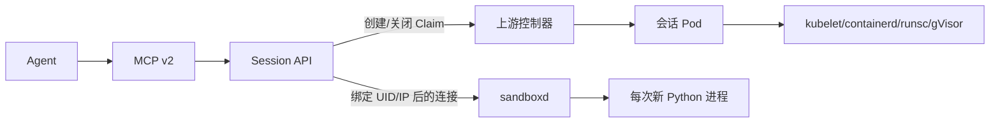

# 会话运行时与身份边界

当前链路为 Agent → stdio MCP v2 → Session API → 会话 Pod 内的上游 sandboxd。执行与生命周期管理由不同主体承担，产品服务不直接启动宿主沙箱。

## 生命周期与数据调用

创建标识绑定 principal、instance、Pool 与有效 TTL；同标识恢复同一命名 Claim。session_id 包含 Claim 实例身份，不能将旧 ID 用于同名新 Claim。首次 Ready 时将 Sandbox/Pod/Service UID 固定写入 Claim；执行环境终止或身份替换后失效，不自动重绑。

每条命令在已领取 Pod 的 /workspace 启动 `python3 -I -B -u -c`。文件由会话工作目录保存，Python 内存变量不跨命令继承。文件端口为受策略约束的上游接口，不开放宿主文件访问。当前模板仅允许固定 CPU/Python 镜像、非 root、只读根文件系统、受限 emptyDir、无集群 token 和默认拒绝网络策略。

同一会话的执行和文件操作通过 Claim UID/resourceVersion CAS 互斥，API 重启不自动释放操作标记。TCP 建连前后分别读取新的完整资源观察，复核 UID/IP、归属、资源唯一性、Service selector、运行边界及当前 Claim 标记，随后固定连接；禁止重新解析 Service、重连或重放命令。结果返回前再观察原身份。该组合依赖可信 Kubernetes/CNI，不是跨系统原子执行证明。

## 所有权与资源

上游管理 Claim/Sandbox/Pod/WarmPool；原生 scheduler/kubelet/containerd 管理调度与运行；官方 runsc handler/gVisor 承担内核运行隔离。API/MCP 只做配置身份、原 UID 绑定、预算和协议适配，没有宿主 socket 或 cgroup 写权限。执行 Pod 不得到模型 key、API token 或 Kubernetes 凭据。

固定预热池的空闲、领取、创建、终止成员共同计入 Worker 和 namespace 预算。API 配额、池规模和实际资源分别核对，不用更多隐藏库存推导性能收益。Kueue/健康 AdmissionCheck 尚未接入，会话命令不以一次性 Job 实现。

## 取消、关闭与保留

HTTP/MCP 断线或客户端截止不等于任务停止。执行/写入结果不确定时保留操作标记，在独立预算内请求上游全会话关闭；调用方不得重放。Agent 不继续批次中的下一条命令，也不再次请求模型规划；已知 ID 的关闭/查询可重试，未确认时保留 cleanup_error，上游硬 TTL 兜底。

只有上游确认本代到期且关联 API 对象均消失，产品才返回 closed/cleanup_complete。首次完整观察的 closed_at 用于元数据保留，不能当作进程退出时间。`agentbox-cleanup` 默认预览，按保留期和原 UID/resourceVersion 删除记录并保存审计；没有 CRI 权限。宿主验收器另外核对实际 gVisor/CRI 进程回收。

范围与限制见[验证](validation.md)、[操作](operations.md)及[工具契约](usage.md)。旧单机调度、动态池、AIMD、直接 runsc 管理代码及历史运行时说明通过[历史版本](archive/legacy-runtime.md)复现。
