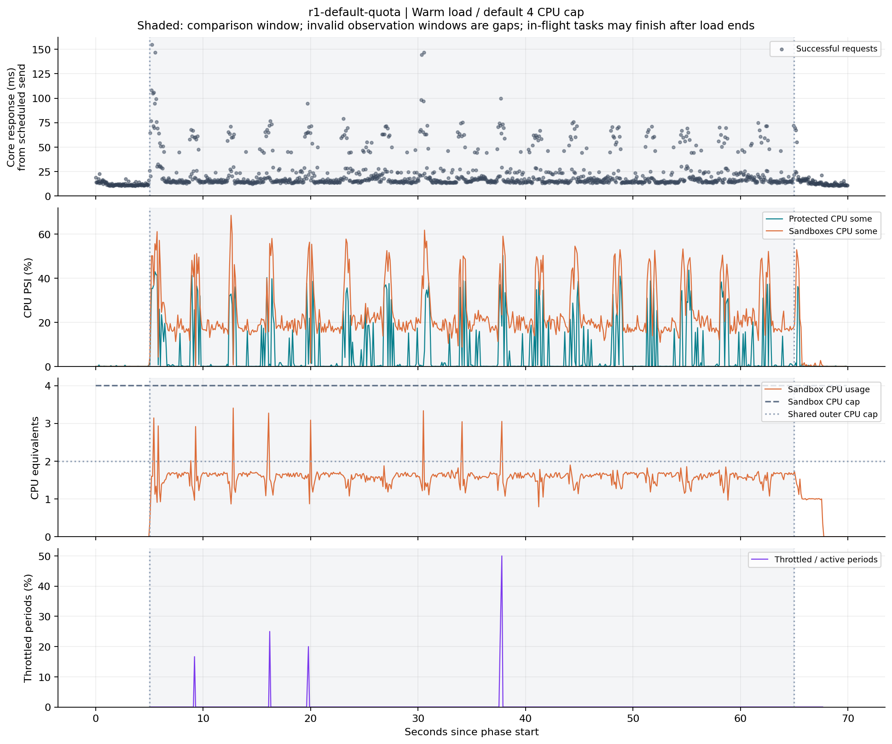
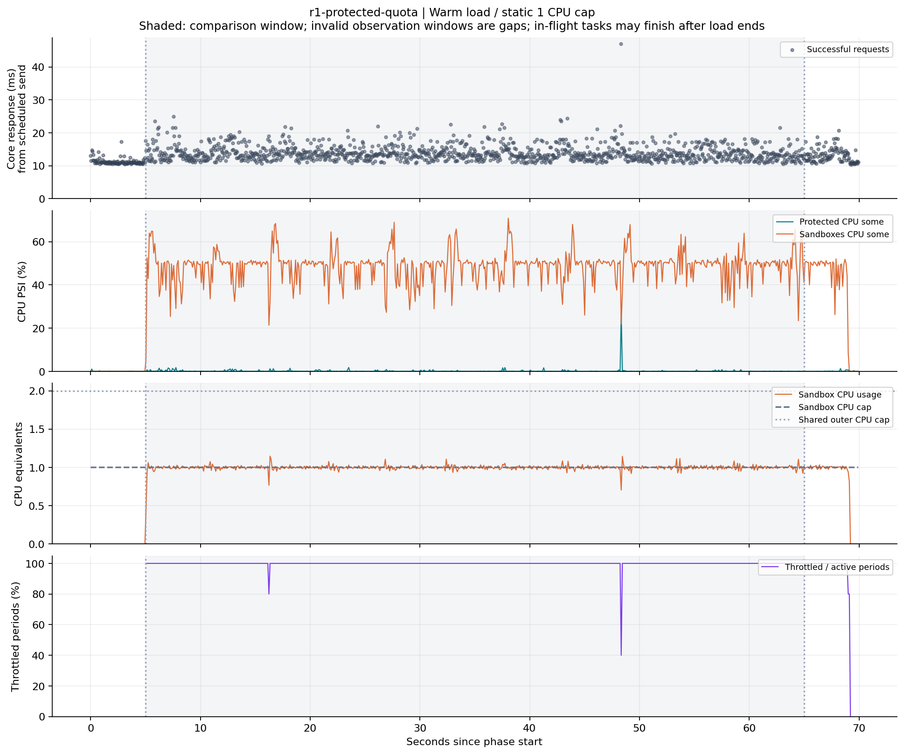

# 静态 CPU 配额实验验收

日期：2026-10-17。本阶段新增的是隔离实验控制器、测量口径与离线绘图，AgentBox 生产执行流程和 observe 模式的只读语义保持原有行为。宿主固定服务没有更新。

## 检查与方法

`make check build` 通过 race 测试、Python 脚本测试、基准汇总测试、vet、格式与语法检查，并构建两个程序。新增七个测量回归用例，覆盖轮换顺序、客户端发送滞后、错误／拒绝／丢弃计数、收尾任务不扩大窗口完成率、无效观测留空、固定整数负载的真实输出校验，以及执行器降级时拒绝生成有效对照图。

初次短实验暴露测试控制器复用已启用控制器的 cgroup，导致第二组启动触发禁止内部进程规则。修正为每组使用独立委派子树。随后宿主高 I/O 压力下出现运行时初始化和 SHA-256 沙箱预热超时；现场读取到 I/O PSI `some avg10` 约 82%。这不足以把超时归因于某一个库，但说明该条件下需要进一步隔离磁盘影响。

最终方法使用固定次数、无额外库导入的 Python 整数运算，将运行时、rootfs、程序、状态和记录放在容器内 1GiB tmpfs，停止组件后才导出结果。三组均采用同样的方法，准备与导出时间不算测量时间。这个实验用于 CPU 预算比较，不衡量磁盘持久化或冷缓存启动。

## KVM 短流程验证

`bash scripts/static-experiment-container.sh kvm 5 1` 成功完成三组请求、配额核对、资源清理与 PNG/SVG 绘图。结果目录：`artifacts/static-kvm-n8M7hz39/`，日志：`artifacts/static-kvm-smoke-4.log`。

实际内核为 `6.8.0-138-generic`，与历史观察阶段的内核不同；本轮单独记录。准备快照约 420MiB。每组比较窗口五秒，前后各五秒核心服务请求，共 300 个成功请求；三组都没有拒绝、丢弃、错误或无效观测帧。

这轮只验证工具链。protected 组两个任务都成功并清理，但完成时刻在五秒比较窗口之后，所以其窗口内完成率为零。这验证了统计不会把收尾任务算进窗口吞吐，也说明正式比较需要更长窗口。

三组时间图和比较图均成功生成，已人工检查文字、坐标、负载标记与数据曲线布局。原始数据与全部图保留在本地 artifacts，使用说明见 [实验文档](static-cpu-experiment.md)。

## 长测中发现的实验环境问题

第一批一分钟、三轮实验在第二轮 protected 组出现两次 `runsc delete` 五秒超时；API 返回基础设施错误，随后停止接单。对应父级内存事件没有 high、max、OOM 或 OOM kill 增量，不能把该现象归因于 OOM。该批次中止，保留在 `artifacts/static-kvm-m4FcLFoV/`，日志为 `artifacts/static-kvm-validation.log`；没有将其故障后 Core 延迟恢复作为保护收益。

实验容器随后改用 Docker init 持续收割孤儿进程，并为运行时宿主侧 `/tmp` 添加独立 tmpfs。另启用 delete 调试日志，并在异常任务 CSV 中保留有大小上限的响应内容。小型隔离容器已验证 init 与控制器均可移入管理叶子，再启用根控制器。

这些是实验环境修正，尚未通过故障现场内核栈证明两次删除超时的精确等待点。排查时核对了实际固定版本的 [sandbox 等待路径](https://github.com/google/gvisor/blob/release-20261005.0/runsc/sandbox/sandbox.go) 与 [非子进程退出等待实现](https://github.com/google/gvisor/blob/release-20261005.0/runsc/specutils/specutils.go)：可用时使用 pidfd，不能直接把历史 zombie 轮询问题当成当前版本的根因。

## 正式三轮 KVM 对照

修正后的 `bash scripts/static-experiment-container.sh kvm 60 3` 成功完成九组测量、固定限制核对、执行器就绪校验、资源清理和全部绘图。结果目录：`artifacts/static-kvm-XCmQHtIX/`，日志：`artifacts/static-kvm-validation-2.log`。本阶段正式测量未与本次构建或回归测试同时运行。

| 组别 | 三轮 Core P99（ms） | 三轮沙箱完成率（次/秒） |
| --- | --- | --- |
| 无沙箱基线 | 19.64 / 21.44 / 17.15 | 0 / 0 / 0 |
| 默认 4 CPU 父级配额 | 94.52 / 81.11 / 80.64 | 0.550 / 0.533 / 0.567 |
| 静态 1 CPU 父级配额 | 21.77 / 23.77 / 22.88 | 0.367 / 0.367 / 0.367 |

Core P99 从计划发送时刻计时，仅统计各组一分钟比较窗口内成功请求；每组每轮 1,200 个样本。包括前后观察窗口，共 12,600 个 Core 请求全部成功。测量任务累计 177 个沙箱成功并清理（默认组 105 个、protected 组 72 个），不含预热任务；窗口结束后的收尾任务保留记录但不计入完成率。没有拒绝、客户端丢弃、传输错误、基础设施错误或观察错误。6,225 帧状态记录全部可用，未出现过期、缺失来源或只建立基线的帧；绘图前逐帧检查执行器均 ready。

各轮关闭后，bundle 与沙箱子 cgroup 均无残留，资源限制在各自测量窗口内保持不变。使用 Docker init 作为监督进程，runsc delete 调试日志写入内存暂存并导出。新批次没有复现先前的删除超时；这仍不足以证明旧批次超时的具体内核等待原因。

本次配额降低使 Core P99 更接近基线，同时降低沙箱完成率。该结论限于外层 2 CPU 的容器条件、指定负载和本轮重复试验，不是裸机性能或动态 QoS 的承诺。

## 耗时与环境证据

依赖快照准备耗时 508.47 秒，使用约 420MiB tmpfs，均在测量窗口之外。九组各有 60 秒比较窗口和前后共 10 秒观察窗口，正式请求发送窗口合计 630 秒，另有预热和收尾。准备复制慢与现场宿主高 I/O 压力同时出现，不能把这段时间当成 API 请求延迟。

对正式测量的沙箱执行 ID 关联 daemon 日志，分别汇总各阶段中位数：

| 阶段 | 默认配额组 | protected 组 |
| --- | --- | --- |
| 准备 | 12.65 ms | 11.88 ms |
| 执行 | 3,402.76 ms | 5,236.14 ms |
| 清理 | 18.03 ms | 22.78 ms |
| 总耗时 | 3,436.08 ms | 5,270.84 ms |

各列是独立分位统计，不能将阶段中位数直接相加得到总中位数。执行段包含固定 800 万次整数运算，protected 组两个客户端共享 1 CPU 带宽，所以这组长任务不能当作 Hello World 或短代码冷启动基准。

```text
kernel: 6.8.0-138-generic
runsc: release-20261005.0
agentboxd SHA-256: adf72e8e10f2764b2c1d23087b54a4fa39e47b42bf61377c488fb12826dc270b
mockcore SHA-256: 5b0ce24e1db10c401a1a66ac970ae444ff0a21ab536586f4f84ee7e0d9e91539
runsc SHA-256: 210b437a9cfae51e8f8c9074ed19b8b5e59477178e2e391a18117d8d6b924f7a
matplotlib: 3.10.9
```

源代码基线为 `d4ccb8def4e65b019e4cfc1d21606ab21726e81c`，工作区包含本阶段未提交修改；测量脚本 SHA-256 已记录。纳入 Git 的 [完整实验汇总](data/static-cpu-experiment.json) 和 [逐轮比较 CSV](data/static-cpu-summary.csv) 来自该批次，原始逐请求 CSV/JSONL 与 SVG 保留在 artifacts。

## 示例图

比较图覆盖全部九组。时间图固定选择第一轮默认与 protected 组，不按效果挑选轮次。





